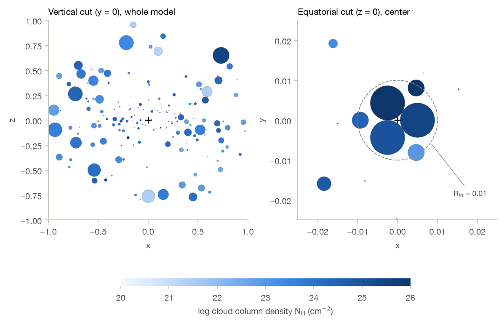
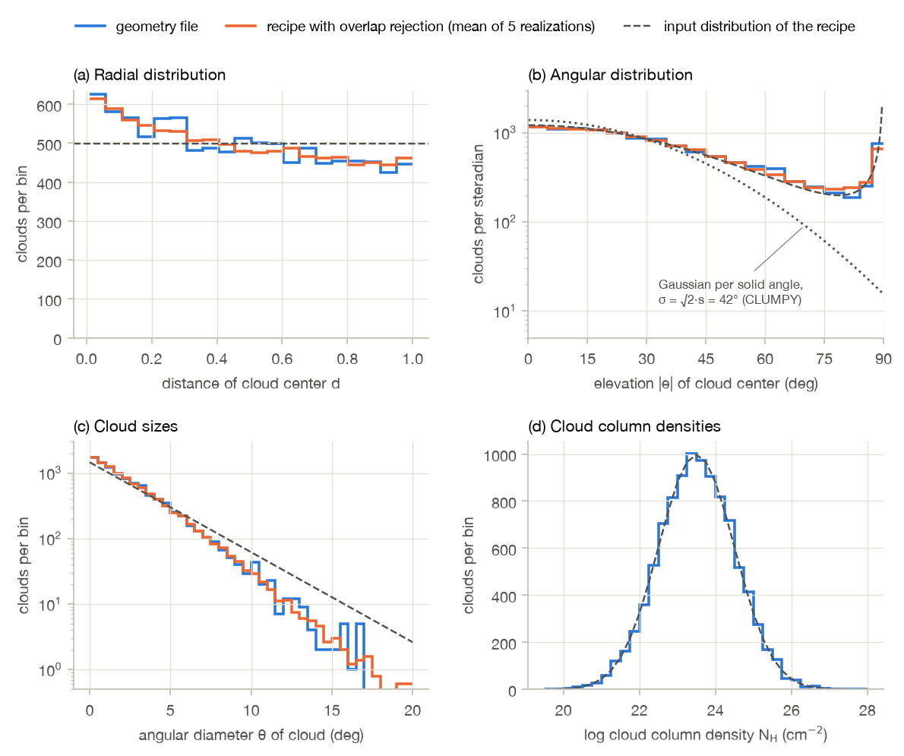
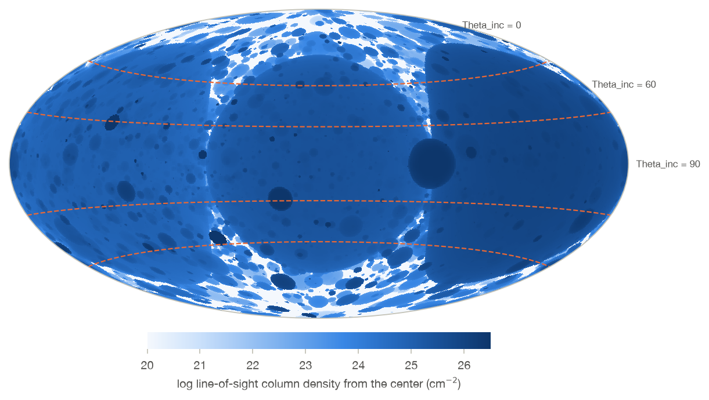
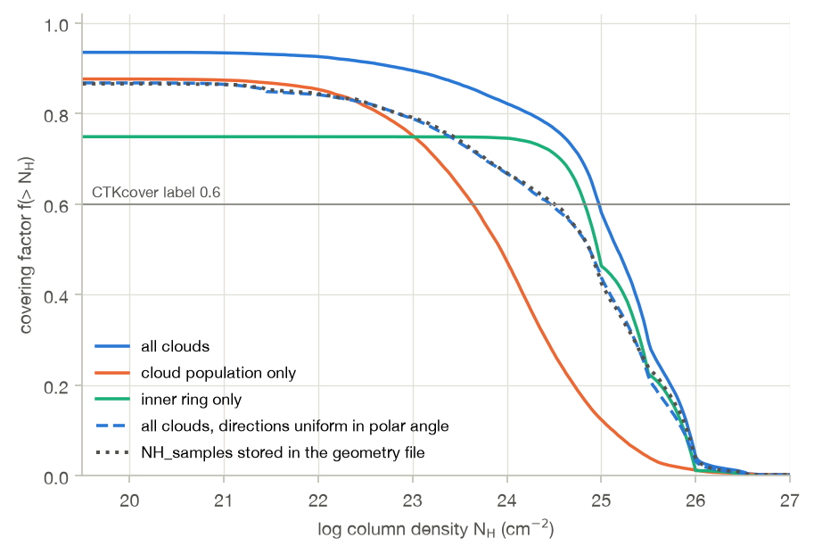
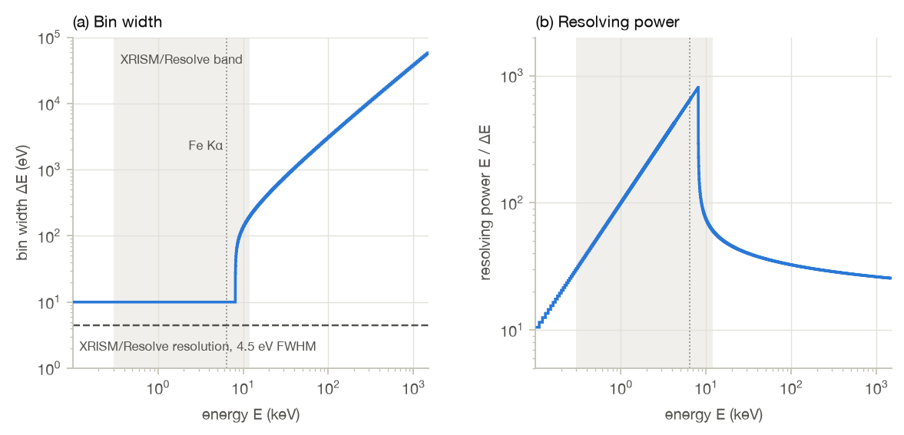

# Reference model

This chapter summarizes the UXClumpy model as described in its documentation, in the XARS code
repository, and in a geometry file obtained from its author. Details marked as to be verified
still need to be checked against the paper, the code, or with the author.

## Geometry

This section describes the geometry based on Sects. 2, 3, and Appendix C of Buchner et al. (2019),
the XARS repository, and an analysis of the geometry file. The cloud generator itself is not part
of the repository.

### Target model versus computed model

The paper first constructs a clumpy model that reproduces the observed column density distribution
of AGN and the observed cloud eclipse rates (Sects. 3.1 and 3.2, Table 2). The spectra of the
released table model, however, were calculated with a less demanding set of values (Sect. 3.3).
The XARS export scripts confirm the computed values: the geometry files are named after 10 000
clouds, and the cloud angular size is derived from the number of clouds as
θcloud = (Ntot / 105)−1/2 degrees.

| Quantity | Target model (Sects. 3.1–3.2, Table 2) | Computed model (Sect. 3.3, XARS scripts) |
| --- | --- | --- |
| total number of clouds Ntot | 105 | 104 |
| characteristic cloud angular size θcloud | 1° | √10 · 1° ≈ 3.16° |
| cloud column density NHcloud | 1023 ± 1.0 cm−2 (Sect. 3.1) | 1023.5 ± 1.0 cm−2 |
| angular width σ | 6° to 90° (Tables 1 and 2) | 0, 7°, 28°, 84° (0 means no cloud population) |
| inner Compton-thick ring | not included | covering factor C = 0, 0.25, 0.3, 0.45, or 0.6 |
| volume filling factor | 2% to 5% (Table 2) | 9% (measured in the geometry file) |

Reducing the number of clouds by a factor of ten while increasing their solid angle by the same
factor keeps the number of clouds along a line of sight unchanged, and the paper reports that the
spectrum is not affected by the number of clouds beyond 104 (Sect. 2.2). The total
cloud volume, however, scales as Ntot θcloud3, so that the volume
filling factor grows by a factor √10, which explains the 9% measured in the geometry file. Table 2
of the paper mixes both sets: it lists 105 clouds of 1°, but the column density
distribution of the computed model. Recreating the released table model requires the values in
the right-hand column.

### Geometry file

The author provided one geometry file, `10000_30_f3_gexp5core.hdf5`, in the format read by the
`ClumpyTorusGeometry` class of XARS. The XARS scripts `torusCcovfrac.py` and `torusCNHeq.py` reveal
the naming scheme of the geometry files for the released table: `10000_<s>_f<n>_gexp5core.hdf5`
for s = 5, 20, 60 and n = 8, 6, 4, 3, where s is the angular width parameter and n the number of
touching spheres in the inner ring (see below). The geometries without a cloud population
(`TORsigma` = 0) use separate files for the ring alone, `dring_25.5_i0.5_n<n>.hdf5`, and an empty
geometry, `dring_empty.hdf5`. The scripts convert s to the `TORsigma` parameter by a factor 1.4,
and n to the `CTKcover` parameter with the table in the section on the inner ring.

The file at hand, with s = 30 and n = 3, thus corresponds to `TORsigma` = 42° and `CTKcover` = 0.6.
It is **not one of the 20 geometries of the released table**. The spectra in Fig. 6 of the paper
were calculated for "one model geometry σ = 30°", which may well be this one. The file contains the
following datasets:

| Dataset | Contents |
| --- | --- |
| `x`, `y`, `z` | cloud center position, in units with Rout = 1 |
| `distance`, `beta`, `phi` | the same position in spherical coordinates; `beta` is the polar angle measured from the symmetry axis, not the elevation above the equatorial plane |
| `radius` | cloud radius |
| `NH` | log10 of the column density through the cloud center, in cm−2; XARS sets the cloud density to this column density divided by the cloud diameter |
| `NH_samples` | 4000 line-of-sight column densities as seen from the center, in cm−2, sorted, with 0.01 for unobscured directions |
| scalars | `sigma` = 30, `m` = 1, `q` = 0, `Y_gas` = 100, `N` = `Ntot` = 10 000, `Ncore` = 3, `filling` = 1, `NHcloud_mean` = 23.5, `NHcloud_sigma` = 1, `N0` = 2.96 |

The first 2 n = 6 clouds form the inner ring; the other 9994 clouds form the cloud population, so
that the total of 10 000 includes the ring. The population clouds are stored in the order in which
they were placed, which turns out to be useful for the analysis below.

*Cross sections through the geometry file, showing the clouds that intersect the plane of the cut.
Left: a vertical cut through the whole model. Right: an equatorial cut through the center, with
the three touching spheres of the inner ring, the three smaller gap-filling spheres between them,
and the innermost population clouds just outside Rin.*

### Cloud population

The clouds are spheres of uniform density, placed around a central point source, with azimuthal
symmetry. The paper describes their distributions in the formalism of the infrared CLUMPY model
(Nenkova et al. 2008). The geometry file shows how these distributions were actually realized. The
first clouds placed follow the input distributions of the recipe closely, while the final
distributions deviate from them in a way that is fully explained by the rejection of overlapping
clouds (see Placement below). The figure compares the file with these input distributions and with
five realizations of the recipe, including the overlap rejection.

*Distributions of the 9994 population clouds in the geometry file (blue), compared with the input
distributions of the recipe (dashed) and with the mean of five realizations of the recipe including
the rejection of overlapping clouds (orange). Panel (b) shows the number of clouds per unit solid
angle; the dotted curve is the Gaussian per unit solid angle of the CLUMPY formalism.*

**Angular distribution.** In the CLUMPY formalism, the mean number of clouds encountered along a
radial line of sight at elevation β above the equatorial plane is

    N(β) = N0 · exp(−(β / σ)^m),    with m = 2,

where N0 is the mean number of clouds along a line of sight in the equatorial plane, and σ is the
angular width, the `TORsigma` parameter. This would correspond to a density of cloud centers per
unit solid angle proportional to exp(−(β / σ)²). The geometry file shows that the elevations of the
cloud centers were instead drawn from a Gaussian distribution **in elevation angle**, with standard
deviation s = `sigma` = 30°, truncated at ±90°, without the factor cos β of the solid angle:

- the first 500 clouds placed are consistent with this distribution (Kolmogorov-Smirnov p = 0.42);
- the number of clouds near the poles matches it: 49, 19, and 6 clouds at elevations above 80°,
  85°, and 88°, compared with 49.7, 19.1, and 6.6 expected;
- per unit solid angle, the density of cloud centers falls off much more slowly towards the poles
  than the CLUMPY Gaussian, and rises again within a few degrees of the poles (panel b).

Near the equatorial plane, the density per unit solid angle is then proportional to
exp(−β² / 2s²), a CLUMPY Gaussian with σ = √2 · s, which explains the conversion factor 1.4 from s
to `TORsigma`. Away from the plane, the density per unit solid angle is proportional to
exp(−β² / 2s²) / cos β, which diverges at the poles. For s = 30° this concerns only a few dozen
clouds, but for s = 60° (`TORsigma` = 84°) the density per unit solid angle increases monotonically
from the equatorial plane to the poles, unlike the description in the paper. The value `m` = 1 in
the file does not match either distribution; its meaning is unknown. N0 is not a free parameter:
it follows from the number and sizes of the clouds. The file lists N0 = 2.96, consistent with the
mean number of 3.05 population clouds that a line of sight in the equatorial plane intersects.

**Radial distribution.** The clouds are distributed over two orders of magnitude in radius, from
Rin to Rout = Y · Rin with Y = 100. In the CLUMPY formalism, the
radial distribution describes the number of clouds per unit length along a radial line of sight,
proportional to r−q, and the paper uses q = 0. Because the angular diameters of the
clouds are drawn independently of their distance, the mean cross section of the clouds at radius r
is proportional to r², so that a constant number per unit length means a constant number per unit
radius. The geometry file confirms this: the distances of the cloud centers are drawn uniformly
between Rin = 0.01 and Rout = 1 (first 500 clouds, p = 0.90). The limits
apply to the cloud centers only: 199 clouds extend beyond Rout, up to a distance of 1.10,
and 4 clouds extend inside Rin. The final distribution has nearly 30% more clouds in the
innermost fifth of the radial range than in the outermost fifth (panel a), because the overlap
rejection is more frequent at large radii, where the clouds are larger.

**Cloud sizes.** The angular diameters θ of the clouds, as seen from the center, are drawn from an
exponential distribution with mean θcloud = √10 · 1° (first 500 clouds, p = 0.69, mean
3.19°), independently of the distance. A cloud at distance d from the center has diameter
D = d · sin θ, so that its radius is d · sin θ / 2. There is no sign of a truncation: the largest
cloud has θ = 27°. Because large clouds are more likely to overlap others, the final distribution
has a mean of 2.49° rather than 3.16°, and a steeper tail (panel c).

**Cloud column densities.** The column density of each cloud through its center, NH =
nH · D, follows a log-normal distribution: log NH (in cm−2) is
normally distributed with mean 23.5 and standard deviation 1.0 (all 9994 clouds, p = 0.27; panel
d). The overlap rejection does not affect this distribution. The uniform hydrogen number density
of the cloud is nH = NH / D, as in the XARS geometry class.

**Placement.** The clouds are placed one at a time. A cloud that overlaps any previously placed
cloud, including the inner ring, is discarded, and a completely new cloud is drawn, including its
size. Two clouds count as overlapping if the distance between their centers is less than 1.0001
times the sum of their radii; the closest pair in the file sits exactly at this limit. The
resulting clouds therefore do not overlap. About 20% of the draws are rejected. Because the chance
of rejection grows as clouds accumulate, the deviations from the input distributions grow with the
placement order. A simulation of this recipe reproduces the trends in the file within the scatter
between realizations:

| Placement order (blocks of 2000 clouds) | 1 | 2 | 3 | 4 | 5 |
| --- | --- | --- | --- | --- | --- |
| mean distance, geometry file | 0.500 | 0.478 | 0.478 | 0.461 | 0.473 |
| mean distance, recipe (5 realizations, scatter ≤ 0.008) | 0.496 | 0.481 | 0.483 | 0.471 | 0.468 |
| mean angular diameter, geometry file | 2.90° | 2.59° | 2.39° | 2.28° | 2.27° |
| mean angular diameter, recipe (scatter ≤ 0.07°) | 2.91° | 2.59° | 2.40° | 2.29° | 2.16° |

The recipe also reproduces the volume filling factor of the file, 9.1% within Rout.
To reproduce the distributions of the released geometries, a recreation must therefore include the
overlap rejection, with the same order of placement.

**Medium between the clouds.** The XARS geometry consists of the clouds only, so that UXClumpy has
no medium between the clouds.

### Inner Compton-thick ring

The released table model adds an optional inner ring of Compton-thick clouds close to the central
source (Sect. 3.3, Fig. 5). A number of identical spheres, just touching each other, form a ring in
the equatorial plane, and a second row of spheres fills the gaps between them, forming a thick
donut. The covering factor C of the ring, the `CTKcover` parameter, determines the number and
radius of the spheres, from sixteen small spheres to three large ones according to the paper.

The geometry file contains a ring with n = 3 touching spheres, constructed as follows (all centers
lie in the equatorial plane):

- the first row has n spheres at distance d1 = 0.005 = Rin / 2, at azimuths
  0°, 120°, and 240°, with radius d1 sin(180° / n) / 1.0001, so that adjacent spheres
  just do not touch; as seen from the center, each sphere covers a cap with a radius of 60°;
- the second row has n spheres at distance d2 = d1 (1 + sin(180° / n)) =
  0.00933, the outer edge of the first row, at the azimuths halfway between the first-row spheres,
  with radius 0.00208 (a cap of 12.9° as seen from the center); the rule that sets this radius is
  not apparent;
- the first-row column densities are exactly log NH = 25.5, 26.0, and 25.0, which
  matches the "25.5_i0.5" in the names of the ring-only files; the second-row column densities are
  26.54, 24.48, and 22.95, apparently drawn at random from a distribution wider than 25.5 ± 0.5.

The model documentation states log NH = 25 ± 0.5 for the ring clouds instead. As seen
from the center, the first row of n touching spheres covers a fraction n (1 − cos(180° / n)) / 2 of
the sky, independent of its distance. The second row adds very little, because it only fills the
narrow cusps between the touching spheres above and below the equatorial plane: for n = 3, the
measured covering factor of the ring is 0.751, of which 0.750 is due to the first row. The
covering factors associated with the `CTKcover` values by the XARS scripts are about 20% lower than
these geometric values:

| `CTKcover` | 0 | 0.25 | 0.3 | 0.45 | 0.6 |
| --- | --- | --- | --- | --- | --- |
| touching spheres n | none | 8 | 6 | 4 | 3 |
| geometric covering factor of the first row | 0 | 0.30 | 0.40 | 0.59 | 0.75 |

Fig. 5 of the paper shows the configuration with six touching spheres and a second row of
gap-filling spheres, and states a covering factor of 30%, compared with the geometric value of 40%.
How the `CTKcover` values were derived is not clear.

### Line-of-sight column densities

The line-of-sight column density as seen from the central source determines which sky bin, and
thus which `NHLOS` value, an escaping photon contributes to (see Calculation method). The sky map
shows these column densities for the geometry file. The inner ring dominates: its three spheres
cover 75% of the sky with column densities above 1024 cm−2, and the cloud
population is visible mainly in the gaps between them and towards the poles.

*Line-of-sight column density from the center for the geometry file, in a Hammer projection with
the equatorial plane horizontal. The dashed lines are the boundaries of the three inclination bins
of the sky binning, labeled with the corresponding `Theta_inc` values.*

The covering factor f(> NH), the fraction of the sky with a line-of-sight column density
above a given value, summarizes this map. For the geometry file, the cloud population alone covers
85% of the sky above 1022 cm−2 and 47% above 1024 cm−2;
with the inner ring, this becomes 93% and 82%.

*Covering factor as a function of column density for the geometry file, for isotropically
distributed directions from the center, and for the stored `NH_samples`. The samples are
reproduced by directions distributed uniformly in polar angle (dashed blue), not by isotropic
directions (solid blue).*

The `NH_samples` stored in the file do not match the isotropic covering factors: they give 84%
above 1022 cm−2 and 67% above 1024 cm−2. They are
reproduced closely by directions distributed uniformly in polar angle, which over-represent the
poles. The XARS script `torusCcovfrac.py` plots the covering factors of the released geometries from
these samples. If the covering factors in the paper (Figs. 2 and C.1) were obtained in the same
way, they are underestimated. The table model itself is not affected, because XARS emits its
photons isotropically and normalizes the sky bins with isotropic directions.

### Recipe

With these ingredients, a geometry for given values of s (= `TORsigma` / 1.4) and n is recreated
as follows:

1. Choose the length unit so that Rout = 1 and Rin = 0.01.
2. Place the inner ring for n touching spheres as described above, if any.
3. Add population clouds one at a time until the total number of clouds, including the ring, is
   10 000. For each cloud, draw a distance d uniformly between Rin and Rout,
   an elevation from a Gaussian distribution with standard deviation s, redrawn until it lies
   between −90° and 90°, and an azimuth uniformly between 0 and 2π. Draw an angular diameter θ from
   the exponential distribution with mean √10 · 1° and set the radius to d · sin θ / 2. Draw
   log NH from the normal distribution with mean 23.5 and standard deviation 1.0, and set
   the density to nH = NH / D. Discard the cloud and draw a new one if it
   overlaps a cloud placed before, with the margin of 1.0001.

The resulting geometry can be checked against the statistics of the geometry file listed above, and
against the column density distributions of Fig. C.1 of the paper, taking into account the
direction sampling of the `NH_samples`.

### Open points

The geometry file settles several details that the paper leaves open:

- the distances of the cloud centers are drawn uniformly in r, not in log r, between
  Rin and Rout, and only the centers need to lie between these limits;
- the angular diameters of the clouds are drawn independently of their distance, with no evident
  truncation;
- the elevations are drawn from a Gaussian in elevation angle, without the solid-angle factor;
- overlapping clouds are rejected and redrawn as a whole, which shapes the final distributions;
- the ring lies at half the inner radius of the cloud population, and its first-row column
  densities are 25.5 ± 0.5 in log NH.

The following points remain to be confirmed with the author:

- whether the 20 geometry files of the released table can be shared, which would make the
  recreation unnecessary and allow a direct comparison with the same clump realizations;
- whether these files were generated with the same code as the geometry file at hand, in particular
  with the same elevation distribution, which matters most for s = 60°;
- the rule that sets the radius of the second-row spheres of the ring, and the distribution of
  their column densities;
- how the `CTKcover` values relate to the geometric covering factors of the ring;
- whether the `NH_samples`, and the covering factors in the paper, were computed for directions
  uniform in polar angle;
- the meaning of the `m` and `filling` values in the file and of the "gexp5core" suffix.

## Table model

### Parameters

The table model has the following parameters. The grid values are those of the table file
`uxclumpy-cutoff.fits` in the current release of the model on
[Zenodo](https://doi.org/10.5281/zenodo.602282), which the documentation refers to as
`uxclumpy.fits`.

| Group | Parameter | Meaning | Grid values |
| --- | --- | --- | --- |
| incident radiation | `PhoIndex` | photon index of the primary power law | 11 values from 1.0 to 3.0, in steps of 0.2 |
| incident radiation | `Ecut` | high-energy cutoff of the primary spectrum, in keV | 5 values: 60, 100, 140, 200, 400 |
| incident radiation | `norm` | photon flux normalization at 1 keV (see Central source) | not tabulated |
| viewing | `NHLOS` | total column density along the line of sight, in 1022 cm−2 | 41 values from 0.01 to 104, in steps of 0.15 dex |
| viewing | `Theta_inc` | viewing angle relative to the inner disk, in degrees | 3 values: 0, 60, 90 |
| geometry | `TORsigma` | vertical extent of the cloud population, in degrees | 4 values: 0, 7, 28, 84 |
| geometry | `CTKcover` | covering factor of the inner Compton-thick ring | 5 values: 0, 0.25, 0.3, 0.45, 0.6 |

The table thus contains 41 × 11 × 5 × 4 × 5 × 3 = 135 300 spectra, calculated from 4 × 5 = 20
geometries. In the table file, the line-of-sight column density parameter is called `nH`.

### Spectral resolution

Each spectrum has 1000 contiguous energy bins from 0.1 to 1517.5 keV, defined by the `bending`
binning module of XARS. The first 800 bins are 10 eV wide and cover 0.1 to 8.1 keV. The other 200
bins have lower edges at 8.1 keV · exp(((i − 800) / A)1.5) for bin index i, with A
chosen so that the first of these bins is 15 eV wide. Their width grows rapidly with energy, to
134 eV at 10 keV, 0.44 keV at 20 keV, 1.4 keV at 50 keV, and 58 keV for the last bin. The
resolving power E / ΔE thus rises from 10 at 0.1 keV to 640 at the Fe Kα line and 810 at 8.1 keV,
and then drops abruptly, to 74 at 10 keV, 36 at 50 keV, and 25 at the high end. Even in the
10 eV part of the grid, the bins are twice as wide as the energy resolution of XRISM/Resolve,
4.5 eV FWHM, and above 8.1 keV they are much wider still.

*Spectral resolution of the UXClumpy table spectra: (a) bin width and (b) resolving power as a
function of energy. The shaded band is the XRISM/Resolve band, from 0.3 to 12 keV, and the dotted
line marks the Fe Kα line at 6.4 keV.*

### Table files

The release contains four table files with the same parameter grid, energy grid, and order of the
spectra. Each table file has a size of about 540 MB.

| File | Contents |
| --- | --- |
| `uxclumpy-cutoff.fits` | the total spectrum along the line of sight: transmitted plus reflected, including the fluorescent lines; this is the main model component |
| `uxclumpy-cutoff-transmit.fits` | the transmitted component: primary photons that escape along the line of sight without interacting |
| `uxclumpy-cutoff-reflect.fits` | the reflected component: Compton-scattered photons and fluorescent lines |
| `uxclumpy-cutoff-omni.fits` | the spectrum of all escaping photons averaged over all directions |

The total spectrum equals the sum of the transmitted and reflected components. For the spectra
checked, the integrated sums agree to within 0.2 percent, and individual bins differ by more than
1 percent only in about 2 percent of the bins, mostly where the values are tiny.

The omni component represents the warm mirror: ionized gas far outside the obscurer that scatters
part of the escaping radiation into the line of sight. This gas sees the obscurer from all
directions, so that it scatters the angle-averaged spectrum, which is dominated by the unobscured
directions and is thus mostly an unobscured power law. The component is added to the main
component with a free scaling constant, typically between 10−5 and 0.1. Its spectra do
not depend on `NHLOS` or `Theta_inc`: for the spectra checked, they are identical for all values of
these parameters, which the table repeats only to share the grid of the other files.

A combination of `NHLOS` and `Theta_inc` that does not occur in a given geometry yields an empty
spectrum. For the spectra checked at `NHLOS` values of 10 and 2510 (1023 and 2.5 ×
1025 cm−2), about 15 percent of the spectra are empty.

The checks above are based on 500 spectra at the lowest `NHLOS` value and 330 spectra at each of
the two other values, for the lowest `PhoIndex` values, read from the four table files.

### Calculation method

UXClumpy was calculated with XARS, a compact Monte Carlo code written in Python, which includes
photoelectric absorption, Compton scattering (with the Klein-Nishina cross section for free
electrons), and fluorescent line emission: Fe Kα and Kβ, and Kα of C, O, Ne, Mg, Si, Ar, Ca, Cr,
and Ni. It assumes solar abundances (Anders & Grevesse 1989) and the photoionization cross sections
of Verner et al. (1996). Three features of the calculation stand out:

- **Response matrices.** XARS injects photons at the center in each energy bin separately, and
  records the energy and direction of the escaping photons. The result is a response matrix (a
  Green's function) that maps injected energy to escaping energy. The spectrum for any incident
  spectrum, and thus for any `PhoIndex` and `Ecut`, follows by multiplying the incident spectrum
  with this matrix, without further simulations.
- **Sky binning.** XARS divides the sky as seen from the central source into bins of similar
  line-of-sight column density, further subdivided by inclination angle. The spectra collected in
  these bins provide the `NHLOS` and `Theta_inc` parameters. For a given geometry, a single
  calculation thus covers all viewing parameters. The paper (Sect. 4.2) states inclination bins of
  0° to 30° (face-on), 30° to 60° (intermediate), and 60° to 90° (edge-on). The XARS script
  `torusC.py`, which computes the response of a clumpy geometry file for 41 column density bins
  and 3 inclination bins, instead divides the sky into three bins of equal solid angle, with
  boundaries at |cos i| = 1/3 and 2/3, where i is the inclination of the escaping photon relative
  to the symmetry axis. The `Theta_inc` grid values 0, 60, and 90 thus represent inclinations of 0°
  to 48.2°, 48.2° to 70.5°, and 70.5° to 90°, respectively. The column density bins are 41 equal
  bins in log NH between 20 and 26 (in cm−2), each 6/41 ≈ 0.146 dex wide,
  labeled with the `NHLOS` grid values, which are spaced by 0.15 dex; lower column densities fall
  in the first bin and higher ones in the last bin. A combination of `NHLOS` and `Theta_inc` that
  does not occur in the geometry yields an empty spectrum.
- **Analytic paths.** The optical depth that a photon travels is drawn at random, but the end point
  is determined analytically, using the LightRayRider library to find the clouds that a ray
  intersects and their order.

As a result, only the geometry parameters `TORsigma` and `CTKcover` require separate
calculations, which explains how a table with many spectra can be produced with a limited number
of simulations.

### Central source

The incident radiation is an isotropic point source at the center of the geometry (Sect. 2.1 and
Appendix A of the paper). XARS draws the initial photon directions uniformly in cos β.

**Injection.** XARS does not emit photons from a given incident spectrum. Instead, it injects the
same number of photons in each of the 1000 energy bins of the table separately, with energies
drawn uniformly within the bin: 106 photons per bin by default in `torusC.py`, and
109 photons across the 1000 bins for the benchmark quoted in Sect. 1 of the paper. The
response matrices thus cover injected energies over the full energy grid, from 0.1 to 1517.5 keV,
and no photons are injected outside this range.

**Incident spectrum.** The export scripts apply the incident spectrum afterwards, by weighting the
response to each injection bin with

    w(E) = E^(−Γ) · exp(−E / Ecut) · ΔE / ΔE0,

evaluated at the bin center E, where Γ is `PhoIndex`, ΔE is the bin width, and ΔE0 = 10 eV is the
width of the bin at 1 keV. The incident spectrum is thus a cutoff power law, constant within each
bin, over the full energy grid, without any other lower or upper limit. The paper (Sect. 6)
correspondingly quotes an energy coverage of 0.1 to 1000 keV. The table confirms this: in the
lowest `NHLOS` bin, where nearly all lines of sight are unobscured, the transmitted spectra follow
w(E) in all 1000 bins, up to the last bin from 1459 to 1517.5 keV, for all spectra checked. The
source spectrum is thus cut off abruptly at 1517.5 keV. For the hardest spectra, with Γ = 1 and
`Ecut` = 400 keV, E2 N(E) in the last bin is still 36 times its value at 1 keV, and a
quarter of its peak value at 400 keV.

**Normalization.** The documentation describes `norm` as the photon flux normalization at 1 keV.
The table spectra are given in photons cm−2 s−1 per bin, and for `norm` = 1
the unobscured transmitted spectra equal w(E) / 123, within 2% for each of 200 spectra checked
(median ratio 0.008130). The same factor applies to the other table files: for the geometry
without clouds, for example, the omni spectra equal w(E) / 123 exactly. The factor 123 = 41 × 3
is the number of sky bins; the export script `createclumpytoruscutofftable.py` in the XARS
repository divides the binned responses by this number, in addition to the fraction of the sky
covered by each bin. As a result, `norm` = 1 corresponds to an intrinsic photon flux density of
100 / 123 ≈ 0.813 photons cm−2 s−1 keV−1 at 1 keV, rather than 1.

### Limitations

Sect. 4.2.4 of Vander Meulen et al. (2023) discusses XARS and compares it with an independent X-ray
radiative transfer code for a uniform wedge torus, one of the geometries released with XARS, with
an opening angle of 60°, free-electron scattering, the abundances of Anders & Grevesse (1989),
column densities from 1021 to 1024 cm−2, and viewing angles of
45° and 75°. It lists the following limitations:

- **No peel-off.** XARS does not use biasing techniques such as peel-off. Photons escape in all
  directions and are averaged over direction bins, which is inefficient, especially for
  non-axisymmetric media, and leaves more Monte Carlo noise in the spectra.
- **No bound-electron scattering.** Compton scattering is treated for free electrons only.
- **Limited fluorescence.** XARS includes 11 fluorescent line transitions, with fluorescent yields
  from Bambynek et al. (1972). It omits, for example, the S Kα line at 2.3 keV, which is more
  important than the Ne and Mg lines that it does include.
- **Photoabsorption cross sections.** The XARS cross sections are 10% to 15% higher below 12.5 keV
  than the phfit2 cross sections (Verner & Yakovlev 1995; Verner et al. 1996) used by the other
  codes in the comparison and by XSPEC, which lowers the soft X-ray flux along obscured lines of
  sight. The UXClumpy paper nevertheless cites Verner et al. (1996) as the source of its cross
  sections.
- **Total flux only.** The comparison is limited to the total flux, because XARS does not output
  the scattered flux separately. This does not apply to UXClumpy, whose table files include the
  transmitted and reflected components separately.

Apart from these differences, the agreement is good for all lines of sight and column densities.
The Compton-dominated part of the spectra at high energies agrees, including the reflection hump
near 40 keV, and so do the spectra between 6.0 and 7.5 keV for heavily obscured lines of sight,
with a column density of 1024 cm−2. In addition, XARS does not include
intrinsic line shapes or the complete set of K- and L-shell lines.
