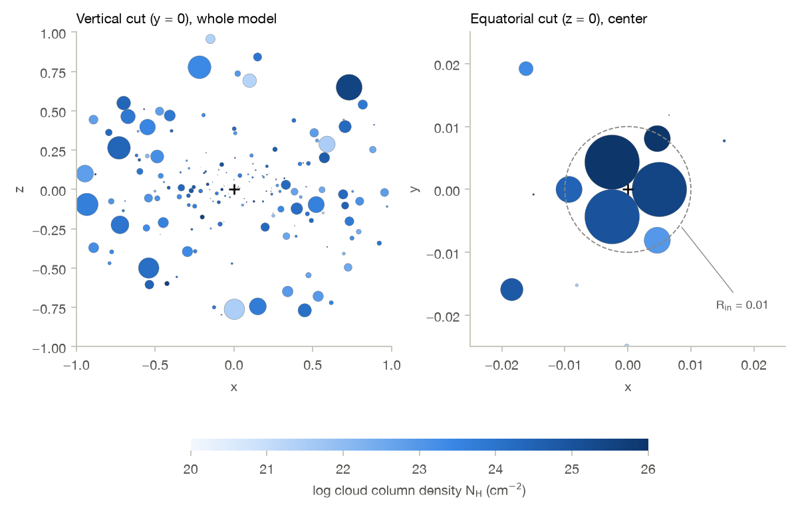
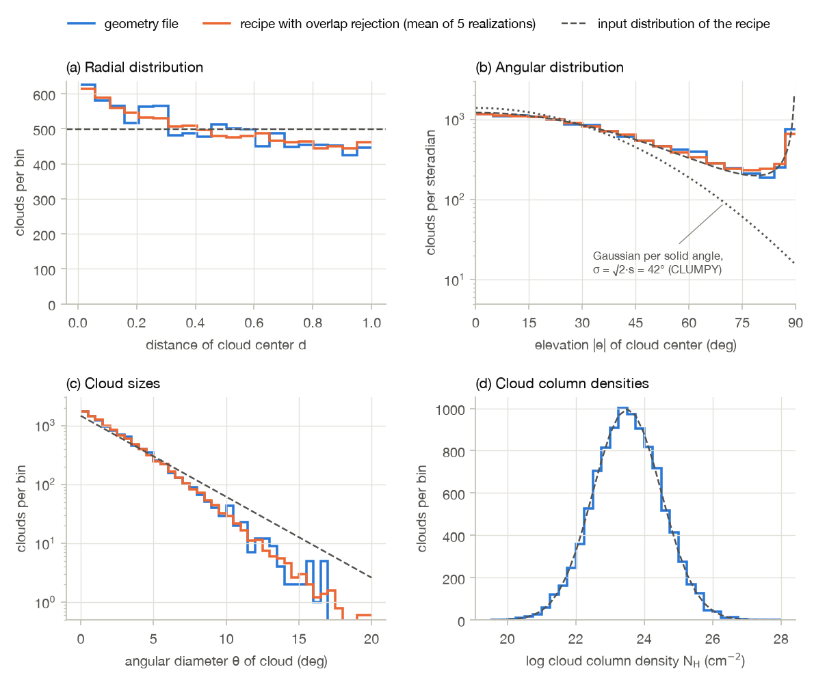
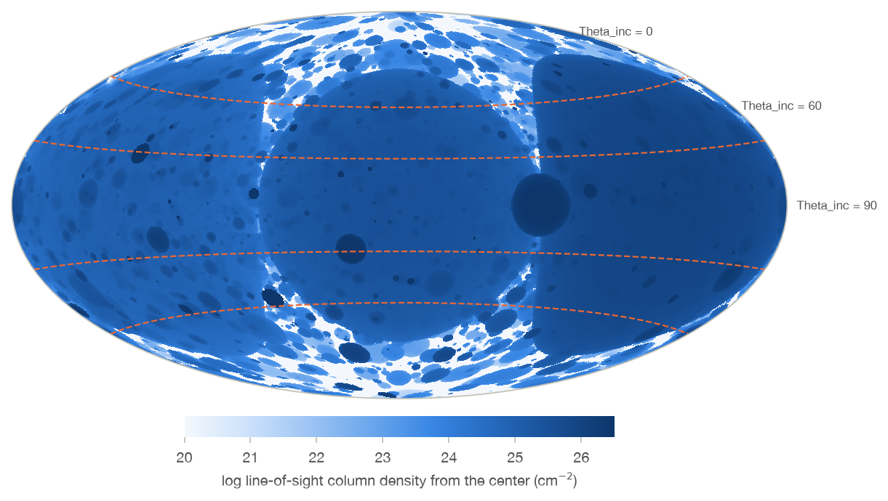
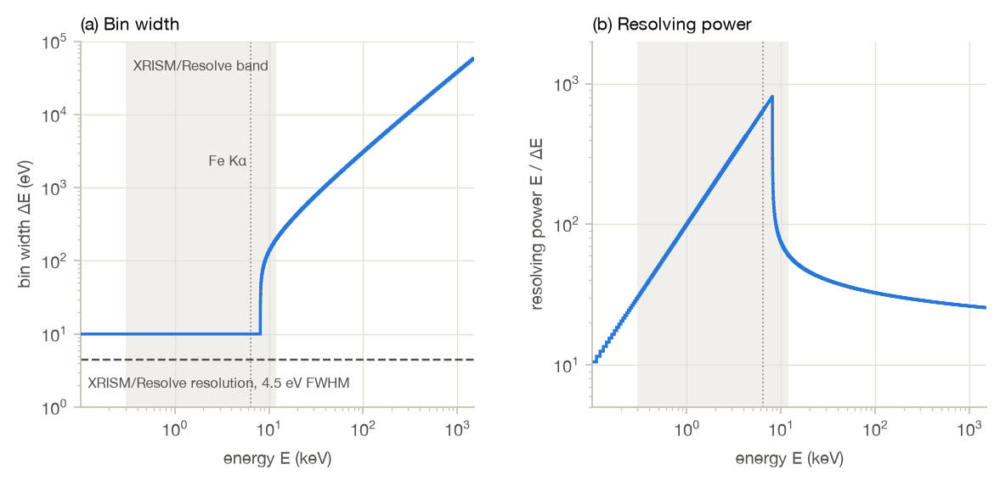
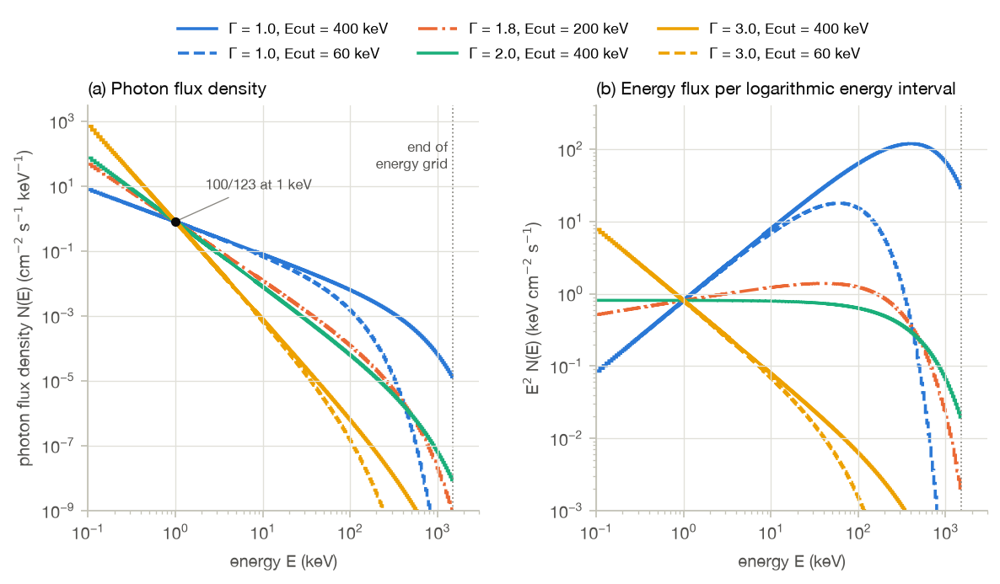
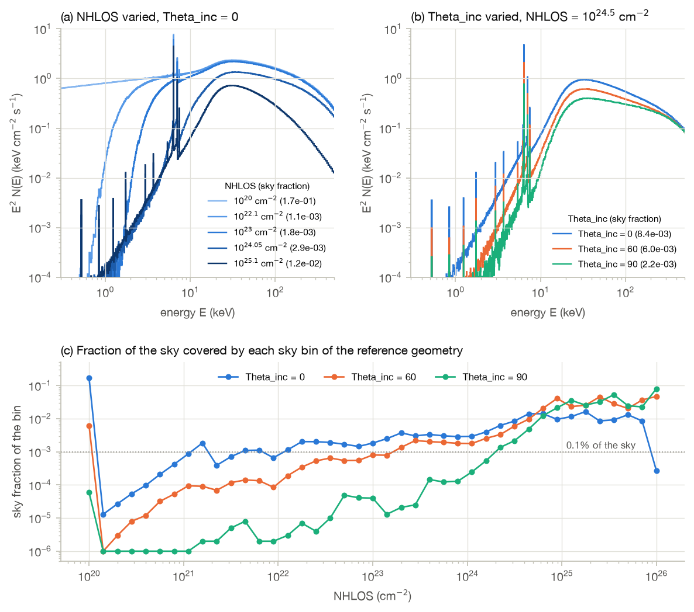
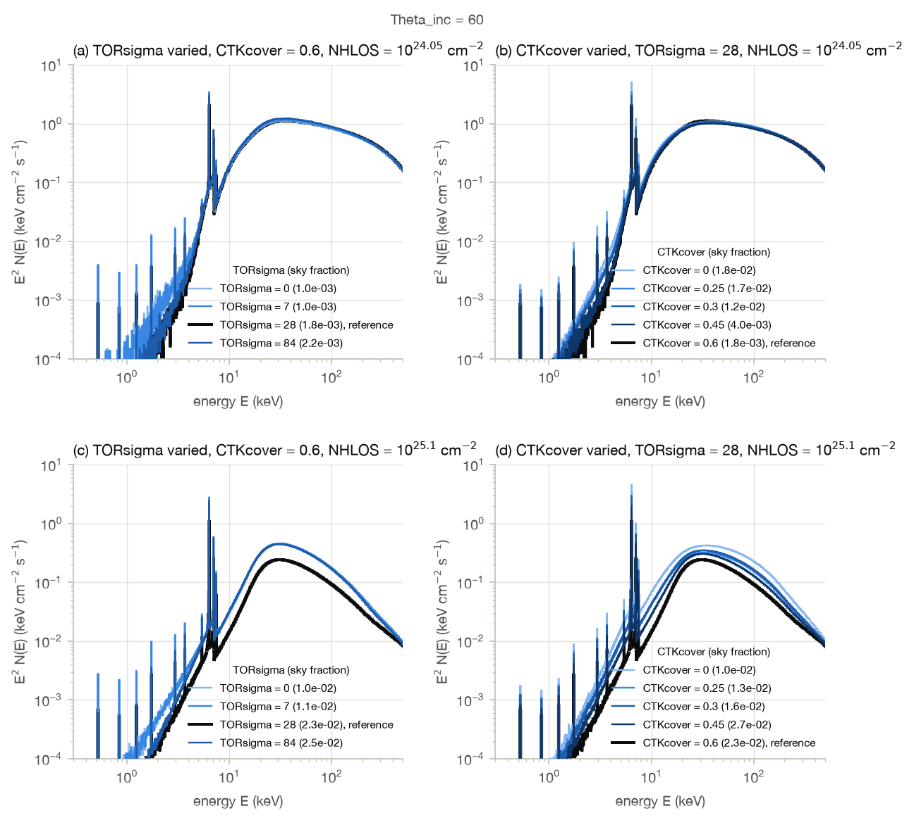

# Reference model

This chapter summarizes the UXClumpy model as described in its documentation, in the XARS code
repository, and in the geometry files obtained from its author. Details marked as to be verified
still need to be checked against the paper, the code, or with the author.

## Geometry

This section describes the geometry based on Sects. 2, 3, and Appendix C of Buchner et al. (2019),
the XARS repository, and an analysis of the geometry files. The cloud generator itself is not part
of the repository.

### Target model versus computed model

The paper first constructs a clumpy model that reproduces the observed column density distribution
of AGN and the observed cloud eclipse rates (Sects. 3.1 and 3.2, Table 2). The spectra of the
released table model, however, were calculated with a less demanding set of values (Sect. 3.3).
The XARS export scripts confirm the computed values: the geometry files are named after 10 000
clouds (see Geometry files), and the cloud angular size is derived from the number of clouds as
θcloud = (Ntot / 105)−1/2 degrees.

| Quantity | Target model (Sects. 3.1–3.2, Table 2) | Computed model (Sect. 3.3, XARS scripts) |
| --- | --- | --- |
| total number of clouds Ntot | 105 | 104 |
| characteristic cloud angular size θcloud | 1° | √10 · 1° ≈ 3.16° |
| cloud column density NHcloud | 1023 ± 1.0 cm−2 (Sect. 3.1) | 1023.5 ± 1.0 cm−2 |
| angular width σ | 6° to 90° (Tables 1 and 2) | 0, 7°, 28°, 84° (0 means no cloud population) |
| inner Compton-thick ring | not included | covering factor C = 0, 0.25, 0.3, 0.45, or 0.6 (see Inner Compton-thick ring) |
| volume filling factor | 2% to 5% (Table 2) | 4% to 9% (measured in the geometry files, see Cloud population) |

Reducing the number of clouds by a factor of ten while increasing their solid angle by the same
factor keeps the number of clouds along a line of sight unchanged, and the paper reports that the
spectrum is not affected by the number of clouds beyond 104 (Sect. 2.2). The total
cloud volume, however, scales as Ntot θcloud3, so that the volume
filling factor grows by a factor √10. The rejection of overlapping clouds reduces it again, the more
so the thinner the cloud population, to the values measured in the geometry files (see Cloud
population). Table 2 of the paper mixes both sets: it lists 105 clouds of 1°, but
the column density distribution of the computed model. Recreating the released table model
requires the values in the right-hand column.

### Geometry files

The author first provided a single geometry file, `10000_30_f3_gexp5core.hdf5`, which is not part
of the released table, and later the files of the 20 geometries of the released table, with a list
that maps them to the table parameters. All files are in the format read by the
`ClumpyTorusGeometry` class of XARS. The geometries with a cloud population are named
`10000_<s>_f<n>_gexp5core.hdf5`, where s is the angular width parameter and n the number of
touching spheres in the inner ring (see Inner Compton-thick ring), with n = 0 for no ring. The
geometries without a cloud population (`TORsigma` = 0, see Parameters) use separate files for the
ring alone, `dring_25.5_i0.5_n<n>.hdf5`, and an empty geometry, `dring_empty.hdf5`. The XARS scripts
`torusCcovfrac.py` and `torusCNHeq.py` use the same naming scheme.

The author's list assigns s = 5, 20, and 60 to `TORsigma` = 7, 28, and 84, and the ring-only files
to `TORsigma` = 0; it assigns n = 0, 8, 6, 4, and 3 to `CTKcover` = 0, 0.25, 0.3, 0.45, and 0.6.
This is the mapping used by the XARS scripts (see the table in Inner Compton-thick ring), and the
sky fractions of the files confirm it for all 20 geometries (see Comparison with the released
geometries). The factor 1.4 ≈ √2 between s and `TORsigma` relates s to the angular width of the
CLUMPY formalism (see Cloud population). The history of the XARS export script
`createclumpytoruscutofftable.py` shows when it was introduced: the script labels its geometries
with a torus opening angle of 90° − s for the geometries with s = 5, 10, 30, and 60 used in 2016,
and of 90° − 1.4 s for the `gexp5core` geometries with s = 5, 20, and 60 used since January 2017,
which corresponds to `TORsigma` = 1.4 s.

The first file, with s = 30 and n = 3, thus corresponds to `TORsigma` = 42° and `CTKcover` = 0.6.
It was generated with the same code and the same random numbers as the released files (see Cloud
population). The spectra in Fig. 6 of the paper were calculated for "one model geometry σ = 30°",
which may well be this one, labeled with s rather than with 1.4 s. The files with a cloud population
contain the following datasets:

| Dataset | Contents |
| --- | --- |
| `x`, `y`, `z` | cloud center position, in units with Rout = 1 |
| `distance`, `beta`, `phi` | the same position in spherical coordinates; `beta` is the polar angle measured from the symmetry axis, not the elevation above the equatorial plane |
| `radius` | cloud radius |
| `NH` | log10 of the column density through the cloud center, in cm−2; XARS sets the cloud density to this column density divided by the cloud diameter |
| `NH_samples` | 4000 line-of-sight column densities as seen from the center, in cm−2, sorted, with 0.01 for unobscured directions |
| scalars | `sigma` = s, `Ncore` = n, `N` = `Ntot` = 10 000, `m` = 1, `q` = 0, `Y_gas` = 100, `NHcloud_mean` = 23.5, `NHcloud_sigma` = 1, `filling` = 0, 1, 0.7, 0.5, and 0.4 for n = 0, 3, 4, 6, and 8, and `N0` from 1.57 to 7.09 (2.96 for the first file) |

The ring-only files contain the same datasets except `beta` and `phi`, and the scalars `NH_mean` =
25.5, `NH_sigma` = 0.5, `sigma` = 25.5, `Ncore` = n, and `filling` = 0.404, 0.551, and 0.903 for
n = 8, 6, and 4, undefined (NaN) for n = 3, and 0 for the empty geometry.

The first 2 n clouds form the inner ring; the other 10 000 − 2 n clouds form the cloud population,
so that the total of 10 000 includes the ring. The population clouds are stored in the order in
which they were placed, which turns out to be useful for the analysis (see Cloud population).

*Cross sections through the first geometry file, showing the clouds that intersect the plane of
the cut. Left: a vertical cut through the whole model. Right: an equatorial cut through the
center, with the three touching spheres of the inner ring, the three smaller gap-filling spheres
between them, and the innermost population clouds just outside Rin.*

### Cloud population

The clouds are spheres of uniform density, placed around a central point source, with azimuthal
symmetry. The paper describes their distributions in the formalism of the infrared CLUMPY model
(Nenkova et al. 2008). The geometry files show how these distributions were actually realized. The
analysis below was done for the first geometry file and confirmed for the released files. The
first clouds placed closely follow the input distributions of the recipe (see Recipe), while the
final distributions deviate from them in a way that is fully explained by the rejection of
overlapping clouds (see Placement below). The figure compares the first file with these input
distributions and with five realizations of the recipe, including the overlap rejection.

*Distributions of the 9994 population clouds in the first geometry file (blue), compared with the
input distributions of the recipe (dashed) and with the mean of five realizations of the recipe
including the rejection of overlapping clouds (orange). Panel (b) shows the number of clouds per
unit solid angle; the dotted curve is the Gaussian per unit solid angle of the CLUMPY formalism.*

**Angular distribution.** In the CLUMPY formalism, the mean number of clouds encountered along a
radial line of sight at elevation β above the equatorial plane is

    N(β) = N0 · exp(−(β / σ)^m),    with m = 2,

where N0 is the mean number of clouds along a line of sight in the equatorial plane, and σ is the
angular width, the `TORsigma` parameter. This would correspond to a density of cloud centers per
unit solid angle proportional to exp(−(β / σ)²). The first geometry file shows that the elevations
of the cloud centers were instead drawn from a Gaussian distribution **in elevation angle**, with
standard deviation s = `sigma` = 30°, truncated at ±90°, without the factor cos β of the solid
angle:

- the first 500 clouds placed are consistent with this distribution (Kolmogorov-Smirnov p = 0.42);
- the number of clouds near the poles matches it: 49, 19, and 6 clouds at elevations above 80°,
  85°, and 88°, compared with 49.7, 19.1, and 6.6 expected;
- per unit solid angle, the density of cloud centers falls off much more slowly towards the poles
  than the CLUMPY Gaussian, and rises again within a few degrees of the poles (panel b).

The released files confirm this distribution for all values of s: the first 500 clouds placed are
consistent with it (p = 0.39 to 0.58 for s = 5, 0.39 to 0.45 for s = 20, and 0.15 to 0.26 for
s = 60), and inconsistent with the CLUMPY Gaussian with σ = 1.4 s (p < 0.01 for s = 20 and
p < 10−17 for s = 60). For s = 5, the two distributions hardly differ, because cos β is
close to 1 for all clouds.

Near the equatorial plane, the density per unit solid angle is then proportional to
exp(−β² / 2s²), a CLUMPY Gaussian with σ = √2 · s, which explains the conversion factor 1.4 from s
to `TORsigma`. Away from the plane, the density per unit solid angle is proportional to
exp(−β² / 2s²) / cos β, which diverges at the poles. For s = 30° this concerns only a few dozen
clouds, but for s = 60° (`TORsigma` = 84°) the density per unit solid angle increases from the
equatorial plane to the poles, unlike the description in the paper. In the released file with
s = 60, it is nearly constant up to an elevation of about 50°, and then rises to five times its
equatorial value within 5° of the poles. There, where the clouds crowd, the overlap rejection
(see Placement) thins them out: 482 clouds lie at elevations above 80°, compared with 563 expected.
The value `m` = 1 in the files does not match either distribution; its meaning is unknown. N0 is not
a free parameter:
it follows from the number and sizes of the clouds. The first file lists N0 = 2.96, consistent with
the mean number of 3.05 population clouds that a line of sight in the equatorial plane intersects.

**Radial distribution.** The clouds are distributed over two orders of magnitude in radius, from
Rin to Rout = Y · Rin with Y = 100. In the CLUMPY formalism, the
radial distribution describes the number of clouds per unit length along a radial line of sight,
proportional to r−q, and the paper uses q = 0. Because the angular diameters of the
clouds are drawn independently of their distance, the mean cross section of the clouds at radius r
is proportional to r², so that a constant number per unit length means a constant number per unit
radius. The geometry files confirm this: the distances of the cloud centers are drawn uniformly
between Rin = 0.01 and Rout = 1 (first 500 clouds, p = 0.90 for the first
file and 0.49 to 0.88 for the released files). The limits apply to the cloud centers only: in the
first file, 199 clouds extend beyond Rout, up to a distance of 1.10, and 4 clouds extend
inside Rin. The final distribution has nearly 30% more clouds in the
innermost fifth of the radial range than in the outermost fifth (panel a), because the overlap
rejection is more frequent at large radii, where the clouds are larger.

**Cloud sizes.** The angular diameters θ of the clouds, as seen from the center, are drawn from an
exponential distribution with mean θcloud = √10 · 1° (first 500 clouds, p = 0.69, mean
3.19°; p = 0.24 to 0.89 for the released files), independently of the distance. A cloud at
distance d from the center has diameter D = d · sin θ, so that its radius is d · sin θ / 2. There
is no sign of a truncation: the largest cloud has θ = 27°. Because large clouds are more likely to
overlap others, the final distribution has a mean of 2.49° rather than 3.16°, and a steeper tail
(panel c). The thinner the cloud population, the more large clouds are rejected: the final mean is
1.90°, 2.38°, and 2.49° in the released files with s = 5, 20, and 60.

**Cloud column densities.** The column density of each cloud through its center, NH =
nH · D, follows a log-normal distribution: log NH (in cm−2) is
normally distributed with mean 23.5 and standard deviation 1.0 (all 9994 clouds, p = 0.27; panel
d). The overlap rejection does not affect this distribution, because the column densities are
assigned independently of the placement (see Shared random numbers below). The uniform hydrogen
number density of the cloud is nH = NH / D, as in the XARS geometry class.

**Placement.** The clouds are placed one at a time. A cloud that overlaps any previously placed
cloud, including the inner ring, is discarded, and a completely new cloud is drawn, including its
size. Two clouds count as overlapping if the distance between their centers is less than the sum
of their radii: in the geometry files, the closest pairs of population clouds lie at 1.00004 to
1.00055 times the sum of their radii. The factor 1.0001 that separates the spheres of the inner
ring (see Inner Compton-thick ring) does not apply here. The resulting clouds therefore do not
overlap. About 20% of the draws are rejected. Because the chance of rejection grows as clouds
accumulate, the deviations from the input distributions grow with the placement order. A
simulation of this recipe (see Recipe) reproduces the trends in the first file within the scatter
between realizations:

| Placement order (blocks of 2000 clouds) | 1 | 2 | 3 | 4 | 5 |
| --- | --- | --- | --- | --- | --- |
| mean distance, first geometry file | 0.500 | 0.478 | 0.478 | 0.461 | 0.473 |
| mean distance, recipe (5 realizations, scatter ≤ 0.008) | 0.496 | 0.481 | 0.483 | 0.471 | 0.468 |
| mean angular diameter, first geometry file | 2.90° | 2.59° | 2.39° | 2.28° | 2.27° |
| mean angular diameter, recipe (scatter ≤ 0.07°) | 2.91° | 2.59° | 2.40° | 2.29° | 2.16° |

The recipe also reproduces the volume filling factor of the first file, 9.1% within Rout.
In the released files, the volume filling factor is 3.6%, 7.8%, and 9.5% for s = 5, 20, and 60,
because the overlap rejection removes more of the large clouds in the thinner cloud populations. A
recreation of these distributions must therefore include the overlap rejection, with the same
order of placement.

**Shared random numbers.** All geometry files, including the first one, were generated from the
same sequence of random numbers. Of the 10 000 clouds in the released file with s = 5 and no ring,
7643 reappear in the file with s = 20, and 6752 in the file with s = 60, with the same distance,
azimuth, and radius, and with an elevation exactly 4 and 12 times larger. The generator thus draws
the elevation as s times a standard normal deviate, and the other clouds presumably differ because
the overlap rejection and the limit of ±90° in elevation decide differently for different s. A
cloud with an elevation beyond ±90° is discarded as a whole, like an overlapping cloud. In the same
way, the first file shares 7357 of its population clouds with the released file with s = 5 and
n = 3, with elevations exactly 6 times larger. Files with the same s but different rings share
nearly all population clouds: 9952 to 9992 of their population clouds also occur in the file
without ring. The column densities, finally, form a single sequence that is assigned to the clouds
by their position in the file, and that is the same in all files, except for the first n
positions, which hold the column densities of the first row of the inner ring (see Inner
Compton-thick ring). The released geometries are thus not independent realizations: geometries
with different parameters contain largely the same clouds, stretched in elevation or partly
replaced by the inner ring.

**Medium between the clouds.** The XARS geometry consists of the clouds only, so that UXClumpy has
no medium between the clouds.

### Inner Compton-thick ring

The released table model adds an optional inner ring of Compton-thick clouds close to the central
source (Sect. 3.3, Fig. 5). A number of identical spheres, just touching each other, form a ring in
the equatorial plane, and a second row of spheres fills the gaps between them, forming a thick
donut. The covering factor C of the ring, the `CTKcover` parameter, determines the number and
radius of the spheres, from sixteen small spheres to three large ones according to the paper.

The geometry files contain rings with n = 3, 4, 6, and 8 touching spheres. For a given n, the
positions and radii of the ring spheres are the same in the ring-only file and in the files with
cloud population. The rings are constructed as follows (all centers lie in the equatorial plane):

- the first row has n spheres at distance d1 = 0.005 = Rin / 2, at azimuths
  k · 360° / n for k = 0, …, n − 1, with radius d1 sin(180° / n) / 1.0001, so that
  adjacent spheres just do not touch; as seen from the center, each sphere covers a cap with a
  radius of 180° / n, for example 60° for n = 3;
- the second row has n spheres at distance d2 = d1 (1 + sin(180° / n)), the
  outer edge of the first row, at the azimuths halfway between the first-row spheres, with radius
  0.00208, 0.00250, 0.00120, and 0.00107 for n = 3, 4, 6, and 8, or 0.48, 0.71, 0.48, and 0.56
  times the radius of the first-row spheres (a cap of 12.9° as seen from the center for n = 3); the
  rule that sets this radius is not apparent;
- the first-row column densities are evenly spaced over 1.5 dex around 25.5: log NH =
  25.5 + 1.5 k / n for k = 0, …, n − 1, reduced by 1.5 where this exceeds 26.25, for example
  25.5, 26.0, and 25.0 for n = 3;
- in the ring-only files, the second-row column densities lie halfway between those of the first
  row, for example 25.75, 26.25, and 25.25 for n = 3, so that all ring spheres are Compton thick;
- in the files with cloud population, the second-row column densities are instead taken from the
  column density sequence of the cloud population (see Shared random numbers in Cloud population),
  drawn from 23.5 ± 1.0: for example 26.54, 24.48, and 22.95 for n = 3, and 21.93 to 24.61 for the
  other values of n.

The ring-only files list `NH_mean` = 25.5 and `NH_sigma` = 0.5, which matches the "25.5_i0.5" in
their names, whereas the model documentation states log NH = 25 ± 0.5 for the ring
clouds. The different second-row column densities in the files with cloud population look
unintended. They change the column density for 4% to 9% of the sky, all of it in the edge-on bin.
As a result, the ring of the files with cloud population, taken on its own, lies at a distance of
0.01 to 0.03 from the corresponding ring-only geometry of the table, whereas the ring-only files
lie at 0.003 to 0.006 (see Comparison with the released geometries).

As seen from the center, the first row of n touching spheres covers a fraction
n (1 − cos(180° / n)) / 2 of the sky, independent of its distance. The second row adds very
little, because it only fills the narrow cusps between the touching spheres above and below the
equatorial plane: for n = 3, the measured covering factor of the ring is 0.751, of which 0.750 is
due to the first row. The covering factors associated with the `CTKcover` values by the XARS
scripts and by the author are about 20% lower than these geometric values, and a few hundredths
higher than the covering factors for directions distributed uniformly in polar angle, as used for
the `NH_samples` in the geometry files (see Line-of-sight column densities):

| `CTKcover` | 0 | 0.25 | 0.3 | 0.45 | 0.6 |
| --- | --- | --- | --- | --- | --- |
| touching spheres n | none | 8 | 6 | 4 | 3 |
| geometric covering factor of the first row | 0 | 0.30 | 0.40 | 0.59 | 0.75 |
| covering factor of the ring for directions uniform in polar angle | 0 | 0.200 | 0.266 | 0.408 | 0.555 |

Fig. 5 of the paper shows the configuration with six touching spheres and a second row of
gap-filling spheres, and states a covering factor of 30%, compared with the geometric value of 40%
and the value of 26.6% for directions uniform in polar angle. How the `CTKcover` values were derived
is not clear.

### Line-of-sight column densities

The line-of-sight column density as seen from the central source determines which sky bin, and
thus which `NHLOS` value, an escaping photon contributes to (see Calculation method). The sky map
shows these column densities for the first geometry file. The inner ring dominates: its three spheres
cover 75% of the sky with column densities above 1024 cm−2, and the cloud
population is visible mainly in the gaps between them and towards the poles.

*Line-of-sight column density from the center for the first geometry file, in a Hammer projection
with the equatorial plane horizontal. The dashed lines are the boundaries of the three inclination
bins of the sky binning (see Calculation method), labeled with the corresponding `Theta_inc`
values.*

The covering factor f(> NH), the fraction of the sky with a line-of-sight column density
above a given value, summarizes this map. For the first geometry file, the cloud population alone
covers 85% of the sky above 1022 cm−2 and 47% above 1024
cm−2; with the inner ring, this becomes 93% and 82%.

*Covering factor as a function of column density for the first geometry file, for isotropically
distributed directions from the center, and for the stored `NH_samples`. The samples are
reproduced by directions distributed uniformly in polar angle (dashed blue), not by isotropic
directions (solid blue).*

The `NH_samples` stored in the first file do not match the isotropic covering factors: they give 84%
above 1022 cm−2 and 67% above 1024 cm−2. They are
reproduced closely by directions distributed uniformly in polar angle, which over-represent the
poles. The XARS script `torusCcovfrac.py` plots the covering factors of the released geometries from
these samples, and the covering factors that the author lists for the released geometries equal
those of their `NH_samples`, to two decimals for all 20 geometries. For isotropic directions, the
covering factors are considerably larger, except for `TORsigma` = 84, where the clouds are spread
over all elevations:

| `TORsigma` | directions | `CTKcover` = 0 | 0.25 | 0.3 | 0.45 | 0.6 |
| --- | --- | --- | --- | --- | --- | --- |
| 0 | isotropic | 0 / 0 | 0.31 / 0.31 | 0.41 / 0.40 | 0.59 / 0.59 | 0.75 / 0.75 |
| 0 | `NH_samples` | 0 / 0 | 0.20 / 0.20 | 0.27 / 0.26 | 0.41 / 0.41 | 0.56 / 0.55 |
| 7 | isotropic | 0.26 / 0.19 | 0.33 / 0.32 | 0.41 / 0.41 | 0.59 / 0.59 | 0.75 / 0.75 |
| 7 | `NH_samples` | 0.16 / 0.12 | 0.21 / 0.21 | 0.28 / 0.27 | 0.41 / 0.40 | 0.57 / 0.57 |
| 28 | isotropic | 0.71 / 0.42 | 0.71 / 0.53 | 0.72 / 0.55 | 0.75 / 0.65 | 0.82 / 0.77 |
| 28 | `NH_samples` | 0.53 / 0.29 | 0.54 / 0.37 | 0.53 / 0.38 | 0.56 / 0.46 | 0.63 / 0.58 |
| 84 | isotropic | 0.88 / 0.49 | 0.92 / 0.63 | 0.94 / 0.70 | 0.96 / 0.79 | 0.98 / 0.88 |
| 84 | `NH_samples` | 0.89 / 0.53 | 0.92 / 0.61 | 0.94 / 0.67 | 0.95 / 0.73 | 0.97 / 0.82 |

*Covering factors above 1022 and 1024 cm−2 (separated by a slash)
of the released geometries, for isotropic directions and from the `NH_samples` in the files; the
latter are the values listed by the author.*

If the covering factors in the paper (Figs. 2 and C.1) were also obtained from the `NH_samples`,
they are underestimated for `TORsigma` ≤ 28. The table model itself is not affected, because XARS
emits its photons isotropically and normalizes the sky bins with isotropic directions (see Central
source).

### Recipe

The geometry files of the released table make a recreation of its geometries unnecessary. With the
ingredients described above, a geometry with the same statistics can be generated for any values
of s (= `TORsigma` / 1.4) and n as follows:

1. Choose the length unit so that Rout = 1 and Rin = 0.01.
2. Place the inner ring for n touching spheres as described above, if any, with Compton-thick
   second-row spheres as in the ring-only files, or with second-row column densities drawn as for
   the cloud population, as in the files with cloud population.
3. Add population clouds one at a time until the total number of clouds, including the ring, is
   10 000. For each cloud, draw a distance d uniformly between Rin and Rout,
   an elevation from a Gaussian distribution with standard deviation s, and an azimuth uniformly
   between 0 and 2π. Draw an angular diameter θ from the exponential distribution with mean
   √10 · 1° and set the radius to d · sin θ / 2. Draw log NH from the normal
   distribution with mean 23.5 and standard deviation 1.0, and set the density to nH =
   NH / D. Discard the cloud and draw a new one if its elevation lies outside ±90° or if
   it overlaps a cloud placed before.

The resulting geometry can be checked against the statistics of the geometry files listed above,
against the column density distributions of Fig. C.1 of the paper, taking into account the
direction sampling of the `NH_samples`, and against the sky fractions of the released geometries.

### Comparison with the released geometries

The fractions of the sky covered by the 123 sky bins of each released geometry follow from the omni
spectra (see Table files). For a given geometry file, the same fractions follow from the column
densities seen from the center along 200 000 isotropic directions, sorted into sky bins as by
`torusC.py` (see Calculation method). The distance between two sets of sky fractions is half the
sum of their absolute differences over all sky bins, which is the fraction of the sky that would
have to move to another bin.

Each of the 20 released geometry files lies at a distance of 0.001 to 0.009 from the table geometry
to which the author's list assigns it, and at a distance of 0.04 or more from all other table
geometries. Distances below 0.01 are expected from the Monte Carlo noise in the sky fractions,
which are estimated here from 200 000 directions and in XARS from 106 directions (see
Example spectra). The sums of the sky fractions, which miss the directions beyond the last `NHLOS`
bin (see Table files), agree to within 0.001. The files are thus those of the released table, with
the mapping given by the author.

The table below compares geometries with the inner ring of the first file (n = 3, `CTKcover` =
0.6) with the released geometries with this ring: the released files with cloud population, the
first file, and geometries generated with the recipe for a given s, in two realizations.

| Geometry | `TORsigma` = 7 | `TORsigma` = 28 | `TORsigma` = 84 | first geometry file |
| --- | --- | --- | --- | --- |
| released file, s = 5 | 0.006 | 0.12 | 0.28 | 0.24 |
| released file, s = 20 | 0.12 | 0.007 | 0.20 | 0.15 |
| released file, s = 60 | 0.28 | 0.20 | 0.006 | 0.09 |
| first geometry file (s = 30) | 0.24 | 0.15 | 0.09 | – |
| recipe, s = 5 | 0.02 | 0.12 | 0.27 | 0.24 |
| recipe, s = 20 | 0.12–0.13 | 0.04–0.06 | 0.19–0.20 | 0.14–0.15 |
| recipe, s = 30 | 0.23–0.24 | 0.14 | 0.11 | 0.05–0.06 |
| recipe, s = 60 | 0.29 | 0.21–0.22 | 0.05–0.06 | 0.10–0.11 |

Each generated geometry lies closest to the released geometry with `TORsigma` = 1.4 s, at a distance
comparable to the distance between the two realizations for the same s (0.01 for s = 5, and 0.06 to
0.07 for the other values). The recipe thus reproduces the released geometries to within the
differences between random realizations. The first geometry file lies far from all released
geometries, between those with `TORsigma` = 28 and 84, and closest to the recipe for s = 30. Its
inner ring alone lies at a distance of 0.02 from the released ring-only geometry, entirely in the
edge-on bin, because its second-row spheres carry column densities of the cloud population (see
Inner Compton-thick ring); the released ring-only file lies at a distance of 0.006.

### Open points

The geometry files, including the 20 files of the released table, settle several details that the
paper leaves open:

- the distances of the cloud centers are drawn uniformly in r, not in log r, between
  Rin and Rout, and only the centers need to lie between these limits;
- the angular diameters of the clouds are drawn independently of their distance, with no evident
  truncation;
- the elevations are drawn from a Gaussian in elevation angle, without the solid-angle factor, for
  all values of s;
- overlapping clouds are rejected and redrawn as a whole, which shapes the final distributions;
- all geometries were generated from the same sequence of random numbers;
- the ring lies at half the inner radius of the cloud population, and its first-row column
  densities are evenly spaced over 1.5 dex around 25.5 in log NH.

The following points remain to be confirmed with the author:

- the rule that sets the radius of the second-row spheres of the ring, and whether these spheres are
  meant to carry column densities of the cloud population in the geometries with cloud population,
  rather than the Compton-thick values of the ring-only geometries;
- how the `CTKcover` values relate to the covering factors of the ring;
- whether the covering factors in the paper were computed from the `NH_samples`, like those listed
  by the author, and thus for directions uniform in polar angle;
- the meaning of the `m` and `filling` values in the files and of the "gexp5core" suffix.

## Table model

### Parameters

The table model has the following parameters. The grid values are those of the table file
`uxclumpy-cutoff.fits` in the current release of the model on
[Zenodo](https://doi.org/10.5281/zenodo.602282), which the documentation refers to as
`uxclumpy.fits`.

| Group | Parameter | Meaning | Grid values |
| --- | --- | --- | --- |
| incident radiation | `PhoIndex` | photon index of the primary power law | 11 values from 1.0 to 3.0, in steps of 0.2 |
| incident radiation | `Ecut` | high-energy cutoff of the primary spectrum, in keV | 5 values: 60, 100, 140, 200, 400 |
| incident radiation | `norm` | photon flux normalization at 1 keV (see Central source) | not tabulated |
| viewing | `NHLOS` | total column density along the line of sight, in 1022 cm−2 (see Calculation method) | 41 values from 0.01 to 104, in steps of 0.15 dex |
| viewing | `Theta_inc` | viewing angle relative to the inner disk, in degrees (see Calculation method) | 3 values: 0, 60, 90 |
| geometry | `TORsigma` | vertical extent of the cloud population, in degrees | 4 values: 0, 7, 28, 84 |
| geometry | `CTKcover` | covering factor of the inner Compton-thick ring | 5 values: 0, 0.25, 0.3, 0.45, 0.6 |

The table thus contains 41 × 11 × 5 × 4 × 5 × 3 = 135 300 spectra, calculated from 4 × 5 = 20
geometries. In the table file, the line-of-sight column density parameter is called `nH`.

### Calculation method

UXClumpy was calculated with XARS, a compact Monte Carlo code written in Python, which includes
photoelectric absorption, Compton scattering (with the Klein-Nishina cross section for free
electrons), and fluorescent line emission: Fe Kα and Kβ, and Kα of C, O, Ne, Mg, Si, Ar, Ca, Cr,
and Ni. It assumes solar abundances (Anders & Grevesse 1989) and the photoionization cross sections
of Verner et al. (1996). Three features of the calculation stand out:

- **Response matrices.** XARS injects photons at the center in each energy bin separately, and
  records the energy and direction of the escaping photons. The result is a response matrix (a
  Green's function) that maps injected energy to escaping energy. The spectrum for any incident
  spectrum, and thus for any `PhoIndex` and `Ecut`, follows by multiplying the incident spectrum
  with this matrix, without further simulations (see Central source).
- **Sky binning.** XARS divides the sky as seen from the central source into bins of similar
  line-of-sight column density, further subdivided by inclination angle. The spectra collected in
  these bins provide the `NHLOS` and `Theta_inc` parameters. For a given geometry, a single
  calculation thus covers all viewing parameters. The paper (Sect. 4.2) states inclination bins of
  0° to 30° (face-on), 30° to 60° (intermediate), and 60° to 90° (edge-on). The XARS script
  `torusC.py`, which computes the response of a clumpy geometry file for 41 column density bins
  and 3 inclination bins, instead divides the sky into three bins of equal solid angle, with
  boundaries at |cos i| = 1/3 and 2/3, where i is the inclination of the escaping photon relative
  to the symmetry axis. The `Theta_inc` grid values 0, 60, and 90 thus represent inclinations of 0°
  to 48.2°, 48.2° to 70.5°, and 70.5° to 90°, respectively. The column density bins are 41 equal
  bins in log NH between 20 and 26 (in cm−2), each 6/41 ≈ 0.146 dex wide,
  labeled with the `NHLOS` grid values, which are spaced by 0.15 dex; lower column densities fall
  in the first bin and higher ones in the last bin. A combination of `NHLOS` and `Theta_inc` that
  does not occur in the geometry yields an empty spectrum (see Table files).
- **Analytic paths.** The optical depth that a photon travels is drawn at random, but the end point
  is determined analytically, using the LightRayRider library to find the clouds that a ray
  intersects and their order.

As a result, only the geometry parameters `TORsigma` and `CTKcover` require separate
calculations, which explains how a table with many spectra can be produced with a limited number
of simulations.

### Spectral resolution

Each spectrum has 1000 contiguous energy bins from 0.1 to 1517.5 keV, defined by the `bending`
binning module of XARS. The first 800 bins are 10 eV wide and cover 0.1 to 8.1 keV. The other 200
bins have lower edges at 8.1 keV · exp(((i − 800) / A)1.5) for bin index i, with A
chosen so that the first of these bins is 15 eV wide. Their width grows rapidly with energy, to
134 eV at 10 keV, 0.44 keV at 20 keV, 1.4 keV at 50 keV, and 58 keV for the last bin. The
resolving power E / ΔE thus rises from 10 at 0.1 keV to 640 at the Fe Kα line and 810 at 8.1 keV,
and then drops abruptly, to 74 at 10 keV, 36 at 50 keV, and 25 at the high end. Even in the
10 eV part of the grid, the bins are twice as wide as the energy resolution of XRISM/Resolve,
4.5 eV FWHM, and above 8.1 keV they are much wider still.

*Spectral resolution of the UXClumpy table spectra: (a) bin width and (b) resolving power as a
function of energy. The shaded band is the XRISM/Resolve band, from 0.3 to 12 keV, and the dotted
line marks the Fe Kα line at 6.4 keV.*

### Central source

The incident radiation is an isotropic point source at the center of the geometry (Sect. 2.1 and
Appendix A of the paper). XARS draws the initial photon directions uniformly in cos β.

**Injection.** XARS injects the same number of photons in each of the 1000 energy bins of the
table separately, with energies drawn uniformly within the bin: 106 photons per bin by
default in `torusC.py`. The response matrices thus cover injected energies over the full energy
grid, from 0.1 to 1517.5 keV, and no photons are injected outside this range.

**Incident spectrum.** The export scripts apply the incident spectrum afterwards, by weighting the
response to each injection bin with

    w(E) = E^(−Γ) · exp(−E / Ecut) · ΔE / ΔE0,

evaluated at the bin center E, where Γ is `PhoIndex`, ΔE is the bin width, and ΔE0 = 10 eV is the
width of the bin at 1 keV. The incident spectrum is thus a cutoff power law, constant within each
bin, over the full energy grid, without any other lower or upper limit. The paper (Sect. 6)
correspondingly quotes an energy coverage of 0.1 to 1000 keV. The table confirms this: in the
lowest `NHLOS` bin, where nearly all lines of sight are unobscured, the transmitted spectra follow
w(E) in all 1000 bins, up to the last bin from 1459 to 1517.5 keV, for all 3300 spectra in this
bin, none of which has an empty bin. The source spectrum is thus cut off abruptly at 1517.5 keV.
For the hardest spectra, with Γ = 1 and `Ecut` = 400 keV, E2 N(E) in the last bin is
still 36 times its value at 1 keV, and a quarter of its peak value at 400 keV.

**Normalization.** The documentation describes `norm` as the photon flux normalization at 1 keV.
The table spectra are given in photons cm−2 s−1 per bin, and for `norm` = 1
the transmitted spectra in the lowest `NHLOS` bin equal w(E) / 123. Over all 3300 spectra in this
bin, the median ratio to w(E) / 123 is 1.0000, and within each spectrum the ratio stays within 3%
of its median for 99% of the bins. The level of the spectra deviates by more than 2% from 1 / 123
for only 8 of the 60 combinations of geometry and `Theta_inc`, by up to 26%. Seven of these are
edge-on views of geometries with an inner ring, and all of them are sky bins that cover at most
1.3% of the sky (see Table files), so that the deviations are consistent with Monte Carlo noise in
the sky fractions, which XARS estimates from 106 random directions. The same factor
applies to the other table files: for the geometry without clouds, the omni spectra equal
w(E) / 123 to within 10−4, and for all geometries, the omni spectra equal the
sky-fraction weighted sum of the total spectra (see Table files). The factor 123 = 41 × 3 is the
number of sky bins; the export script `createclumpytoruscutofftable.py` in the XARS repository
divides the binned responses by this number, in addition to the fraction of the sky covered by
each bin. As a result, `norm` = 1 corresponds to an intrinsic photon flux density of 100 / 123 ≈
0.813 photons cm−2 s−1 keV−1 at 1 keV, rather than 1.

**Representative spectra.** The figure shows the source spectrum for `norm` = 1, read from the omni
spectra of the geometry without clouds, for the four extreme combinations of `PhoIndex` and `Ecut`
and for two intermediate ones: Γ = 1.8 with `Ecut` = 200 keV, close to typical values for nearby
AGN, and Γ = 2.0 with `Ecut` = 400 keV, close to the spectrum used for Fig. 6 of the paper (Γ = 2
without cutoff) and to the starting point recommended by the documentation, which suggests
freezing `Ecut` at 400 keV initially. All spectra share the normalization at 1 keV, apart from the
factor exp(−1 keV / `Ecut`), which is at least 0.98. For Γ < 2, E2 N(E) peaks at
(2 − Γ) · `Ecut`, for example at 400 keV for the hardest spectrum, whereas for Γ ≥ 2 it decreases
monotonically with energy, so that the lowest energies dominate the energy flux.

*Representative source spectra for `norm` = 1, read from the omni spectra of the geometry without
clouds: (a) photon flux density and (b) E2 N(E), for the extreme and two intermediate
combinations of `PhoIndex` (Γ, color) and `Ecut` (line style). The dot marks the photon flux
density of 100 / 123 at 1 keV, and the dotted line the end of the energy grid at 1517.5 keV.*

### Table files

The release contains four table files with the same parameter grid, energy grid, and order of the
spectra. Each table file has a size of about 540 MB.

| File | Contents |
| --- | --- |
| `uxclumpy-cutoff.fits` | the total spectrum along the line of sight: transmitted plus reflected, including the fluorescent lines; this is the main model component |
| `uxclumpy-cutoff-transmit.fits` | the transmitted component: primary photons that escape along the line of sight without interacting |
| `uxclumpy-cutoff-reflect.fits` | the reflected component: Compton-scattered photons and fluorescent lines |
| `uxclumpy-cutoff-omni.fits` | the spectrum of all escaping photons averaged over all directions |

The statements below were verified for all 135 300 spectra of the four files.

The total spectrum equals the sum of the transmitted and reflected components, with one exception.
For 19 of the 20 geometries, the integrated photon fluxes agree to within 10−7, and no
bin differs by more than 1%. For the geometry with `TORsigma` = 28 and `CTKcover` = 0.25, however,
38% of the bins differ by more than 1%, and the integrated photon fluxes by up to 15%. These
differences are largest at low `NHLOS`, with 15% at 0.02 and up to 4% for the other values below
1, and remain below 0.5% from `NHLOS` = 1.26 upwards. Because the omni spectra of this geometry are
consistent with its total spectra (see below), its transmitted and reflected components appear to
come from a different simulation run than its total spectra.

The omni component represents the warm mirror: ionized gas far outside the obscurer that scatters
part of the escaping radiation into the line of sight. This gas sees the obscurer from all
directions, so that it scatters the angle-averaged spectrum, which is dominated by the unobscured
directions and is thus mostly an unobscured power law. The component is added to the main
component with a free scaling constant, typically between 10−5 and 0.1. Its spectra do
not depend on `NHLOS` or `Theta_inc`: they are identical for all values of these parameters, which
the table repeats only to share the grid of the other files. For each geometry, the omni spectrum
equals the sum of the total spectra of all 123 sky bins, weighted with the fraction of the sky
covered by each bin, to within the floating-point precision of the table (10−7).
These fractions add up to 1 for the geometry without clouds, but to 0.937 to 0.995 for the other
geometries. This is consistent with `torusC.py`, which discards photons that escape in a direction
with a column density beyond the last `NHLOS` bin, above about 1026.15 cm−2,
so that these directions are absent from all four table files.

A combination of `NHLOS` and `Theta_inc` that does not occur in a given geometry yields an empty
spectrum, with zeros in all bins of the total, transmitted, and reflected components. Of the
135 300 spectra, 20 735 (15.3%) are empty, the same for all values of `PhoIndex` and `Ecut`. All
empty spectra belong to the geometries with `TORsigma` = 0 or 7, and the geometry without clouds
has spectra only at the lowest `NHLOS`. The fraction of empty spectra is 0 at the lowest `NHLOS`,
32% at 0.0141, decreasing to 13% from 0.112 to 112, then 15% from 158 to 7080, and 22% at
104. It is 31% for `Theta_inc` = 0, 8% for 60, and 7% for 90. In spectra that are not
empty, the transmitted component is empty at the highest `NHLOS` values, where hardly any photon
escapes without interacting (for 42 of the 47 non-empty combinations of geometry and `Theta_inc` at
104, 13 of 51 at 7080, and 2 of 51 at 5010), and for three combinations at low `NHLOS`.
The reflected component is empty for the geometry without clouds and for 50 combinations at
`NHLOS` ≤ 0.63 in geometries with `TORsigma` = 0 or 7.

### Example spectra

The figures below illustrate the effect of the viewing and geometry parameters on the total
spectrum, for a single source spectrum with Γ = 1.8 and `Ecut` = 200 keV, close to typical values
for nearby AGN (see Central source), and `norm` = 1. The first geometry file, used for most of the
analysis above (`TORsigma` = 42, `CTKcover` = 0.6), is not part of the table, so that the closest
released geometry with the same inner ring, `TORsigma` = 28 and `CTKcover` = 0.6, serves as the
reference geometry.

Each spectrum collects the photons that escape into one sky bin, so that its Monte Carlo noise
depends on the fraction of the sky covered by that bin (see Table files). These fractions are
multiples of 10−6, consistent with the 106 random directions from which XARS
estimates them. In the reference geometry, the inner ring blocks nearly all lines of sight at low
elevations. For `Theta_inc` = 90, which like each inclination bin covers a third of the sky, only
0.07% of the sky has a column density below 1024 cm−2, and 30% has
1025 cm−2 or more; for `Theta_inc` = 60, these numbers are 2% and 27%. The
spectra for these low column densities are thus based on very few photons. In the face-on bin
(`Theta_inc` = 0), most column densities cover 0.1% of the sky or more, which is why it is used to
show the effect of `NHLOS`.

*Total spectra of the reference geometry (`TORsigma` = 28, `CTKcover` = 0.6) for Γ = 1.8,
`Ecut` = 200 keV, and `norm` = 1: (a) for five values of `NHLOS` at `Theta_inc` = 0, and (b) for
the three values of `Theta_inc` at `NHLOS` = 1024.5 cm−2, with the sky
fraction of each bin in the legends; (c) fraction of the sky covered by each sky bin of the
reference geometry.*

With increasing `NHLOS` (panel a), the photoelectric cutoff moves to higher energies. Above about
1024 cm−2, the transmitted component disappears, and the spectrum is dominated
by the reflected component, with the Compton hump near 30 keV and a soft scattered continuum three
to four orders of magnitude below the incident spectrum. The fluorescent lines (Kα of O, Ne, Mg,
Si, Ar, Ca, Cr, Fe, and Ni, and Fe Kβ) appear as spikes in single 10 eV bins. At `NHLOS` =
1024.5 cm−2 (panel b), the spectra for the three inclinations have similar
shapes, but the Compton hump of the face-on spectrum is 1.6 and 2.4 times higher than for
`Theta_inc` = 60 and 90, respectively.

*Total spectra for Γ = 1.8, `Ecut` = 200 keV, `norm` = 1, and `Theta_inc` = 60, varying `TORsigma`
at `CTKcover` = 0.6 (left) and `CTKcover` at `TORsigma` = 28 (right), for `NHLOS` =
1024.05 cm−2 (top) and 1025.1 cm−2 (bottom). The
reference geometry is drawn in black, and the legends list the sky fraction of each bin.*

The figure for the geometry parameters uses `Theta_inc` = 60, for which the sky bins of all
geometries shown cover at least 0.1% of the sky at both column densities. At `NHLOS` =
1024.05 cm−2, close to the Compton-thick threshold, the transmitted component
still carries 60% to 70% of the photon flux between 10 and 100 keV, and the spectra of the
different geometries differ by at most 24% at 30 keV and 10% at 100 keV. They differ mainly in the
soft scattered component, by up to a factor 3.7 in photon flux between 0.5 and 3 keV, and in the
fluorescent lines. At `NHLOS` = 1025.1 cm−2, the transmitted component has
disappeared, and the level of the Compton hump varies by up to a factor 1.9 between geometries.
This dependence is not monotonic: at `CTKcover` = 0.6, `TORsigma` = 0, 7, and 84 give nearly the
same hump, while `TORsigma` = 28 gives about half of it, and at `TORsigma` = 28 the hump generally
decreases with `CTKcover`. Similar irregularities occur for the other inclinations and column
densities, presumably because the lines of sight in a given sky bin pass through different
structures, the inner ring or the cloud population, in different geometries. The omni spectra, in
contrast, vary smoothly with both geometry parameters.

### Limitations

Sect. 4.2.4 of Vander Meulen et al. (2023) discusses XARS and compares it with an independent X-ray
radiative transfer code for a uniform wedge torus, one of the geometries released with XARS, with
an opening angle of 60°, free-electron scattering, the abundances of Anders & Grevesse (1989),
column densities from 1021 to 1024 cm−2, and viewing angles of
45° and 75°. It lists the following limitations:

- **No peel-off.** XARS does not use biasing techniques such as peel-off. Photons escape in all
  directions and are averaged over direction bins, which is inefficient, especially for
  non-axisymmetric media, and leaves more Monte Carlo noise in the spectra.
- **No bound-electron scattering.** Compton scattering is treated for free electrons only.
- **Limited fluorescence.** XARS includes 11 fluorescent line transitions, with fluorescent yields
  from Bambynek et al. (1972). It omits, for example, the S Kα line at 2.3 keV, which is more
  important than the Ne and Mg lines that it does include. In addition, XARS does not include
  intrinsic line shapes or the complete set of K- and L-shell lines.
- **Photoabsorption cross sections.** The XARS cross sections are 10% to 15% higher below 12.5 keV
  than the phfit2 cross sections (Verner & Yakovlev 1995; Verner et al. 1996) used by the other
  codes in the comparison and by XSPEC, which lowers the soft X-ray flux along obscured lines of
  sight. The UXClumpy paper nevertheless cites Verner et al. (1996) as the source of its cross
  sections.

Apart from these differences, the agreement is good for all lines of sight and column densities.
The Compton-dominated part of the spectra at high energies agrees, including the reflection hump
near 40 keV, and so do the spectra between 6.0 and 7.5 keV for heavily obscured lines of sight,
with a column density of 1024 cm−2.
