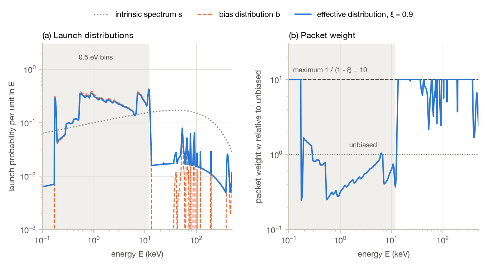
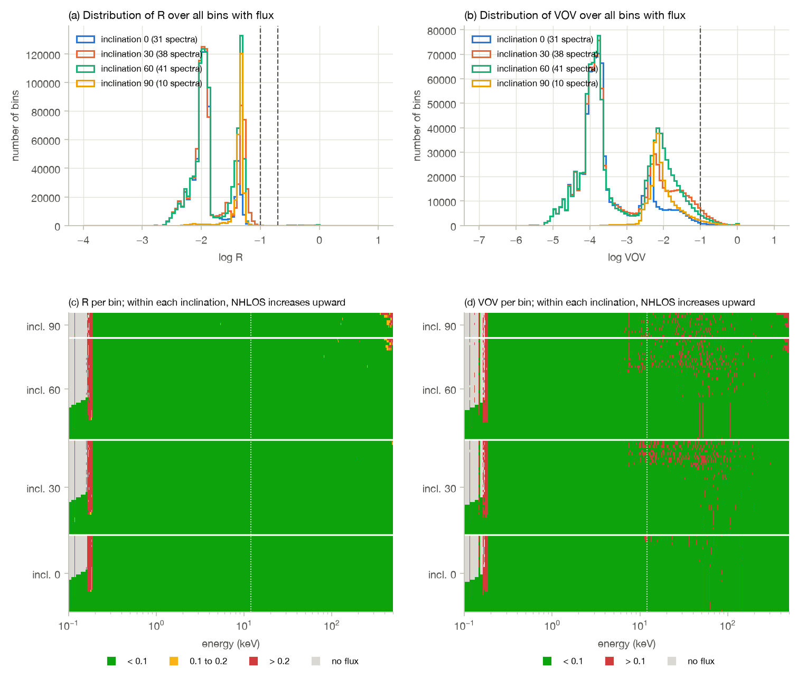
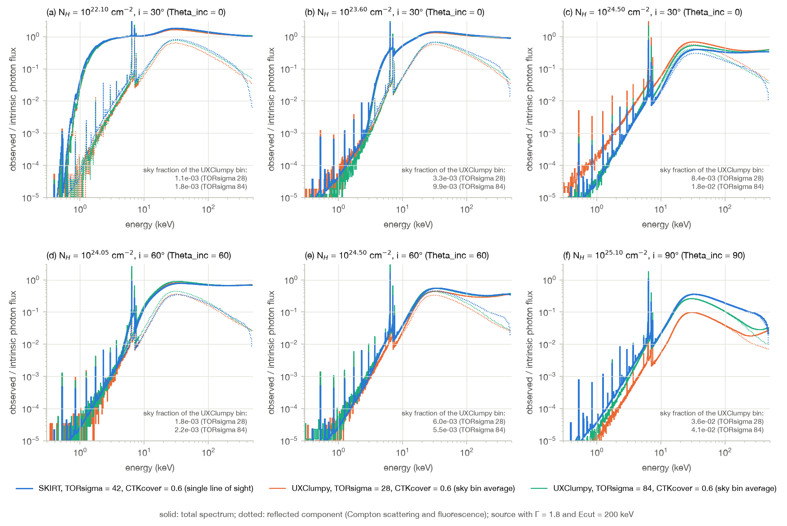
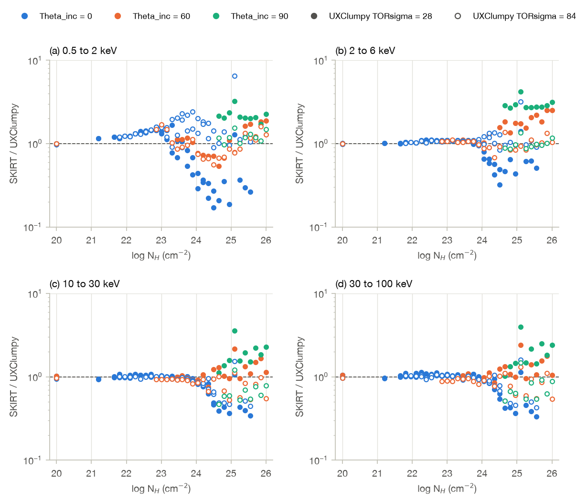
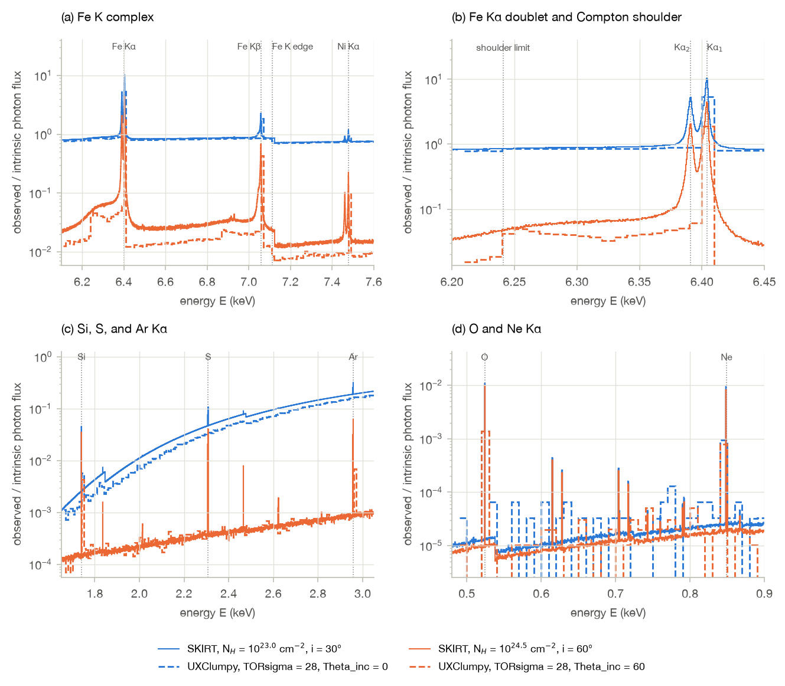

# SKIRT pilot run

## Setup

### Geometry

The pilot run uses the geometry file provided by the author of UXClumpy,
`10000_30_f3_gexp5core.hdf5`, with 10 000 clouds including an inner ring of six clouds (see
Reference model). Using this file avoids recreating the cloud distribution. Its clouds are converted
to a text column file bundle named `clouds` in the HDF5 input file of the pilot run, which is read
by both the `ParticleMedium`, with the `UniformSmoothingKernel`, and the
`ClumpySphericalSpatialGrid`. The bundle lists the center position and radius of each cloud,
scaled to an outer radius Rout of 1 pc, an arbitrary choice because the X-ray
radiative transfer depends only on column densities. Its last column lists the number of hydrogen
atoms in each cloud, nH (4π / 3) r3 with nH = NH /
(2 r) as in XARS, because a `ParticleMedium` imports a number rather than a density. A test run
confirmed that the grid accepts all 10 000 clouds, with a spatial domain extending to 1.1 pc, and
that SKIRT recovers the intended density of every cloud.

The geometry corresponds to `TORsigma` = 42 and `CTKcover` = 0.6 and is not part of the released
table, so that its spectra can be compared with the table spectra only indirectly, for example
through the closest released geometry with the same inner ring, `TORsigma` = 28 and `CTKcover` =
0.6, which serves as reference geometry for the example spectra in the Reference model chapter.

### Source

An isotropic point source at the center emits a cutoff power law with photon index Γ = 1.8 and
cutoff energy `Ecut` = 200 keV, in the range from 0.1 to 500 keV. This is the source spectrum
used for the example output spectra in the Reference model chapter, and it is close to typical
values for nearby AGN. The range is capped at 500 keV, above which the cross sections of the SKIRT
X-ray material mix are zero, whereas the UXClumpy source extends to 1517.5 keV (see Next steps).
For this source spectrum, the photons above 500 keV carry only 0.9% of the energy emitted up to
1517.5 keV.

The source spectrum is provided to SKIRT in the tabulated column format read by `FileSED`, as a
text column file bundle named `source_spectrum` in the HDF5 input file of the pilot run, a
capability introduced in SKIRT 10. The bundle lists the energy in keV and the photon luminosity
per unit energy in 1/s/keV, with an arbitrary normalization, since the luminosity is normalized in
the ski file.

**Resolution of the table.** SKIRT interpolates a tabulated spectrum log-log, which reproduces a
power law exactly. The interpolation error is caused only by the exponential cutoff and amounts to
h2 / 8 · E / `Ecut` for points spaced by h in ln E. Points spaced uniformly in √E
distribute this error evenly over the energy range: 1200 such points keep the maximum relative
error below 10−6 (8.5 × 10−7), whereas logarithmically spaced points would
require about 4800 points. The number of points hardly affects the performance, because SKIRT
samples the wavelength of a photon packet with a single binary search in the cumulative
distribution, so that the cost grows only with the logarithm of the number of points. A test run
with a luminosity probe confirmed that SKIRT reads the bundle and reproduces the cutoff power law
to within 10−6.

### Spectral resolution

The instruments record the spectra on an energy grid with two parts:

- from 0.1 to 12 keV, bins with a constant width of 0.5 eV, which amounts to 23 800 bins;
- from 12 to 500 keV, 2000 bins whose width grows by a constant factor of 1.00416 from one bin to
  the next, starting at 0.5 eV, so that the bin width increases linearly with energy, to 2.0 keV
  for the last bin.

In the second part, the resolving power E / ΔE thus decreases smoothly from 24 000 at 12 keV, the
value for the last 0.5 eV bin, to 2800 at 13 keV, 590 at 20 keV, 320 at 50 keV, 270 at 100 keV,
and 250 at 500 keV. Above 12 keV, the spectra contain no fluorescent lines, and hard X-ray
instruments have a much lower resolution than XRISM/Resolve. The upper limit of 500 keV is that of
the source (see Source). The grid thus has 25 800 bins, compared with 1000 for UXClumpy (see
Spectral resolution in the Reference model chapter), and the 0.5 eV part accounts for 92% of them.
The 0.5 eV bins sample the energy resolution of XRISM/Resolve, 4.5 eV FWHM, with about nine bins
per resolution element.

*Spectral resolution of the instrument wavelength grid of the pilot run, compared with that of the
UXClumpy table spectra: (a) bin width and (b) resolving power as a function of energy. The shaded
band is the XRISM/Resolve band, from 0.3 to 12 keV, and the dotted line marks the Fe Kα line at
6.4 keV.*

A grid that is linear in energy is not linear in wavelength, and the resolving power of the second
part is not constant, so that neither part can be configured with one of the built-in wavelength
grids. Instead, a single `FileBorderWavelengthGrid` lists all 25 801 bin borders in keV. Like the
source spectrum, the borders are provided as a text column file bundle, named `wavelength_grid`,
in the HDF5 input file of the pilot run. A test run with a luminosity probe on this grid confirmed
that SKIRT reads the bundle and constructs the 25 800 bins as intended.

### Sight lines

UXClumpy provides spectra for the 41 `NHLOS` values, from 1020 to 1026
cm−2 in steps of 0.15 dex, and for three inclination bins (see Calculation method in
the Reference model chapter). The pilot run uses instruments at four nominal inclinations: 0°,
30°, 60°, and 90°. For each inclination, there are up to 41 instruments, with azimuths chosen so
that the column density along the line of sight from the central source equals the `NHLOS` grid
values. The azimuths thus differ from one geometry to the next, and grid values that do not occur
near a given inclination are missing. As in UXClumpy, the lowest grid value stands for unobscured
lines of sight. In terms of the UXClumpy inclination bins, the nominal inclinations 0° and 30°
both fall in the face-on bin (0° to 48.2°), 60° in the intermediate bin (48.2° to 70.5°), and 90°
in the edge-on bin (70.5° to 90°).

The column density through a uniform sphere drops continuously to zero at its edge, so that the
column density along a ring of constant inclination is a continuous function of the azimuth, and
every value between its minimum and maximum along the ring is reached exactly. The search thus
needs no tolerance on the column density. It finds all azimuths at which the column density equals
a grid value, on rings within a small range of inclinations around the nominal value, and selects
the direction where the column density changes most slowly with direction, to keep the line of
sight away from cloud edges where possible. The ranges are ±1° around 30° and 60°, 89° to 90°
for 90°, and 2° to 4° for 0°, because a ring at exactly 0° degenerates to a single direction,
which in this geometry passes through a cloud with NH ≈ 1024.2
cm−2. Unobscured lines of sight are placed in the middle of the widest unobscured
stretch of these rings. For the geometry file, this yields 120 instruments:

| Nominal inclination | Instruments | Inclinations | Missing `NHLOS` values (cm−2) |
| --- | --- | --- | --- |
| 0° | 31 | 2° to 4° | 1024.65 to 1026 |
| 30° | 38 | 29° to 31° | 1025.7 to 1026 |
| 60° | 41 | 59° to 61° | none |
| 90° | 10 | 89° to 90° | 1020 to 1024.5 |

Near the poles, the clouds are sparse, so that column densities above 1024.5
cm−2 do not occur, whereas every edge-on line of sight crosses the inner ring, so that
all column densities are higher than that.

*Line-of-sight column density from the center over azimuth and inclination, for the range of
inclinations searched around each nominal inclination, with the selected sight lines (orange
dots). The structures are individual clouds; the white areas are unobscured.*

Most lines of sight cross the interior of a cloud, where log NH changes by at most a
few dex per degree. The lowest column densities, up to between 1020.75 and
1022.1 cm−2 depending on the inclination, are however reached only by
grazing the edge of a thicker cloud, where the column density rises steeply from zero, and the
gradient reaches up to 6 × 104 dex per degree. The inclinations and
azimuths are therefore specified to 8 decimals, which keeps the column densities within
3 × 10−5 dex of the grid values. Such grazing lines of sight are legitimate: the
UXClumpy sky bins for these column densities also cover only a tiny fraction of the sky (see
Example spectra in the Reference model chapter).

A test run with the 120 instruments in a narrow wavelength bin at 30 keV confirmed the directions.
The optical depth, derived from the direct and transparent fluxes recorded by each instrument, is
zero for the unobscured lines of sight, and its ratio to the computed column density is the same
for all other lines of sight to within 1.1 × 10−5.

### Wavelength bias

The source samples the energy of each photon packet from the intrinsic spectrum with probability
1 − ξ, and from a bias distribution with probability ξ, the `wavelengthBias` property of the source.
With s and b the intrinsic and bias distributions per unit ln E, a packet launched at energy E
carries the weight w = s / ((1 − ξ) s + ξ b), which never exceeds 1 / (1 − ξ), so that the expected
spectra do not change. The pilot run uses ξ = 0.9 and a bias distribution provided as a text column
file bundle named `wavelength_bias` in the HDF5 input file, read by a `FileWavelengthDistribution`.

**Need for a bias.** Launched from the intrinsic spectrum, half of the packets would have energies
above 12 keV, where the spectra need relatively few packets. Below 12 keV, the 0.5 eV bins are much
narrower (see Spectral resolution), and the spectra of obscured lines of sight consist of faint
scattered light, which takes many packets to sample. Moreover, packets at high energies are
expensive: above about 10 keV, Compton scattering dominates over absorption, so that a packet
scatters many times, each time peeling off to all instruments. A packet launched at 7 to 12 keV
costs about 10 times as much as one at 0.1 to 0.2 keV, and one above 100 keV about 30 times.

**Construction.** The bias distribution is derived from the reliability statistics of a pilot run
with the same configuration: the relative error R and the variance of the variance VOV of each bin
(see the SKIRT user guide), with the thresholds R < 0.1 and VOV < 0.1. Assuming that R2
and the VOV scale as 1 / n, with n the number of packets launched at energies within the bin, these
statistics give the number of packets needed in each bin. Bins with negligible flux, and bins
dominated by fluorescent lines, which stem from packets launched at higher energies, are left out.
The number needed for each bin is the 90th percentile over the 120 spectra, so that nearly all
spectra are balanced, including the obscured ones. Expressed per unit ln E and smoothed over
0.025 dex, this number is the target launch density. The bias distribution makes the effective
density (1 − ξ) s + ξ b proportional to the target, except where the intrinsic part alone already
exceeds it.

**Choice of ξ.** Combined with the measured cost per packet, the same noise model predicts that the
run time decreases by a factor 1.9 from ξ = 0.5 to 0.9, and by less than 4% for larger values,
while the maximum weight 1 / (1 − ξ) keeps growing. Packets with large weights launched above
12 keV also add noise at lower energies after Compton scattering, which the noise model does not
capture, so that ξ = 0.9 is a good compromise.

**Effect.** Compared with the intrinsic spectrum, the bias distribution moves most launches from
above 12 keV to the range of the 0.5 eV bins:

| Energy range | Intrinsic spectrum | Effective distribution (ξ = 0.9) |
| --- | --- | --- |
| 0.1 to 0.17 keV | 3.5% | 0.4% |
| 0.17 to 12 keV | 46% | 92% |
| 12 to 500 keV | 50% | 8% |

Between 0.17 and 12 keV, the packets carry weights between 0.25 and 1.7. Below 0.17 keV, where only
nearly unobscured lines of sight carry relevant flux, and at most energies above 12 keV, the weights
reach the maximum of 10. In a run with this bias distribution, 2.1 × 108 packets suffice
to meet the thresholds in 99% of the bins for 90% of the spectra. According to the noise model,
launching from the intrinsic spectrum would require 2.2 times as many packets, at a mean cost per
packet 2.4 times higher, and the SKIRT default, a bias distribution uniform in ln E with ξ = 0.5,
would take about as long. The bias distribution thus reduces the run time by a factor of about 5.

*Wavelength bias of the pilot source: (a) launch probability per unit ln E for the intrinsic
spectrum s, the bias distribution b, which drops to a negligible floor where it is not needed, and the
effective distribution (1 − ξ) s + ξ b with ξ = 0.9; (b) weight of the launched packets relative to
unbiased launching. The shaded band marks the part of the instrument grid with 0.5 eV bins.*

## Results

The results come from a run with 5 × 108 photon packets and the configuration described
in Setup.

### Reliability

At this number of packets, the relative error R is below 0.1 in 99.8% of all bins with flux, with a
median of 0.012, and the VOV is below 0.1 in 98.1% of the bins. Leaving out the bins that carry no
relevant flux or are dominated by fluorescent lines (see Wavelength bias), both thresholds are met
in 99% of the bins for 90% of the spectra, the criterion for which the wavelength bias was designed.
The remaining bins with R above 0.1 lie near 0.17 keV, where the flux is negligible, and above 300
keV in the most obscured spectra. The bins with VOV above 0.1 are scattered between about 7 and 100
keV, mostly in the spectra of obscured lines of sight.

*Reliability statistics of the pilot run with 5 × 108 packets: distribution of (a) the
relative error R and (b) the VOV over all bins with flux, per nominal inclination, with the
thresholds as dashed lines; (c) R and (d) VOV of each bin as a function of energy, with the spectra
sorted by inclination and, within each inclination, by `NHLOS`. The dotted line marks 12 keV.*

Assuming that R2 and the VOV scale as 1 / N, the statistics give the number of packets
needed to reach each threshold. The figure below shows this number as a function of energy, for this
run and for a run with five times fewer packets. For R, both runs give the same number everywhere,
so that R decreases as expected, and the number is nearly constant from 0.2 to 12 keV, as intended
by the wavelength bias; the R threshold alone would be reached with about 1.4 × 108
packets. For the VOV, the runs agree below about 6 keV, but above 7 keV the longer run needs more
packets, by a factor of 2 at 7 to 10 keV, rising to 4 at 30 to 80 keV and to more than 10 near 100
keV, where the VOV determines the number of packets needed. In these bins, a few packets carry a
large part of the flux, and a longer run samples rarer and larger contributions, so that the VOV
decreases more slowly than 1 / N. A shorter run thus underestimates the number of packets needed at
these energies. The large contributions occur in the reflected component of Compton-thick lines of
sight; whether they stem from the packets launched above 12 keV, which carry the maximum weight, or
from the geometry of the peel-off paths remains to be investigated.

*Number of photon packets needed to reach R < 0.1 (blue) and VOV < 0.1 (orange) as a function of
energy, assuming that both scale as 1 / N, for the run with 5 × 108 packets (solid) and a
run with 108 packets and the same configuration (dashed). For each bin, the number is the
90th percentile over the spectra, considering only the relevant bins; each point is the 90th
percentile over the bins in a cell of 0.05 dex. The dotted line marks the number of packets of the
longer run, and the shaded band the 0.5 eV bins.*

The fluxes of both runs agree within their errors. In the bins dominated by the transmitted
component, the median flux ratio is 1.0000, and in the bins dominated by scattered light, it is
1.003, with differences beyond three times the combined relative error in 0.7% of these bins.

### Comparison with UXClumpy

The geometry of the pilot run (`TORsigma` = 42, `CTKcover` = 0.6) is not part of the UXClumpy table,
so that its spectra are compared with those of the two released geometries on either side, with
`TORsigma` = 28 and 84 and the same inner ring, for the same source spectrum. Both are expressed as
the ratio of the observed to the intrinsic photon flux on the UXClumpy energy bins up to 500 keV,
which avoids any difference in normalization. A SKIRT spectrum is that of a single line of sight
with the `NHLOS` grid value, whereas a UXClumpy spectrum averages over all directions in its sky bin,
which spans 0.15 dex in column density and a wide range of inclinations (see Calculation method in
the Reference model chapter). Sky bins covering less than 0.1% of the sky are left out, because their
spectra contain few photons.

*Observed-to-intrinsic photon flux for six sight lines of the pilot run (blue), compared with the
UXClumpy total spectra for the same `NHLOS` and inclination bin for `TORsigma` = 28 (orange) and 84
(green), both with `CTKcover` = 0.6, on the UXClumpy energy bins. Solid lines show the total
spectrum, dotted lines the reflected component (Compton scattering and fluorescence). Each panel
lists the fraction of the sky covered by the UXClumpy sky bins.*

*Ratio of the SKIRT to the UXClumpy observed-to-intrinsic photon flux in four energy bands, for all
sight lines of the pilot run, as a function of the column density, with the color indicating the
UXClumpy inclination bin and filled (open) symbols the geometry with `TORsigma` = 28 (84). Only sky
bins covering at least 0.1% of the sky are included.*

The comparison shows the following:

- **Compton-thin lines of sight.** Up to 1024 cm−2, the spectra agree to
  within 10% from 2 to 100 keV for both geometries, including the Compton hump of the reflected
  component. Below 2 keV, the transmitted flux of SKIRT is higher, by a factor that grows with the
  optical depth, to about 2 between 1 and 2 keV at 1023.3 cm−2, as expected
  from the photoabsorption cross sections of XARS, which are 10% to 15% higher below 12.5 keV (see
  Limitations in the Reference model chapter).
- **Compton-thick lines of sight.** Above 1024 cm−2, the ratios above 2 keV
  scatter between about 0.3 and 4. For `Theta_inc` = 60 and 90, the SKIRT spectra above 10 keV
  mostly lie between those of the two geometries, as expected for `TORsigma` = 42; for `Theta_inc` =
  0, they lie below both, by up to a factor 3. The reflected light that reaches a single line of
  sight depends on its surroundings, and the UXClumpy spectra of the two geometries themselves
  differ by similar factors, so that these differences are no sign of an error in either code. A
  like-for-like comparison requires a SKIRT run for a released geometry, with spectra averaged over
  the sky bins.
- **High energies.** Above about 200 keV, the reflected component of SKIRT falls off, because the
  source stops at 500 keV, whereas UXClumpy also includes photons Compton-scattered down from
  higher energies (see Source).

### Spectral detail

The 0.5 eV bins of the pilot run resolve the shapes of the fluorescent lines, which the 10 eV bins
of UXClumpy reduce to single-bin spikes. The figure shows four small energy ranges for a Compton-thin
line of sight, dominated by the transmitted component, and a Compton-thick one, dominated by the
reflected component.

- **Fe K complex** (panels a and b). The Fe Kα1 and Kα2 lines at 6.404 and
  6.391 keV are fully resolved, with Kα1 about twice as strong. SKIRT emits the Kα and Kβ
  lines of Cr to Cu with the intrinsic line shapes measured in the lab (Hölzer et al. 1997), whose
  Lorentzian wings are visible in the figure. For the Compton-thick line of sight, the Compton
  shoulder extends from the line down to 6.24 keV, the energy of a line photon scattered straight
  back, where the UXClumpy spectrum shows the same onset. The Fe Kβ line with its own shoulder, the
  Fe K edge at 7.11 keV, and the Ni Kα doublet near 7.47 keV are also resolved.
- **Lighter elements** (panels c and d). Besides the Kα lines of O, Ne, Si, and Ar, which UXClumpy
  also includes, the SKIRT spectra show lines that UXClumpy lacks: S Kα at 2.31 keV, Kα of P and Cl,
  Kβ of Si and S, and L-shell lines of Fe between 0.6 and 0.8 keV. These lines have no intrinsic
  width in SKIRT, apart from thermal broadening, so that each occupies a single 0.5 eV bin.

The noise is low enough to show these features clearly: R is 0.4% to 0.5% at the peak of the Fe Kα
line, 1.2% to 1.6% in the Compton shoulder, and about 5% in the soft continuum.

*Observed-to-intrinsic photon flux in four small energy ranges, at the 0.5 eV resolution of the
pilot run, for a Compton-thin (blue, 1023 cm−2 at 30°) and a Compton-thick
(orange, 1024.5 cm−2 at 60°) line of sight, with the UXClumpy spectra of the
geometry with `TORsigma` = 28 and `CTKcover` = 0.6 for the same `NHLOS` and inclination bin (dashed):
(a) Fe K complex; (b) Fe Kα doublet and Compton shoulder; (c) Kα lines of Si, S, and Ar; (d) Kα
lines of O and Ne, with L-shell lines of Fe in between.*
