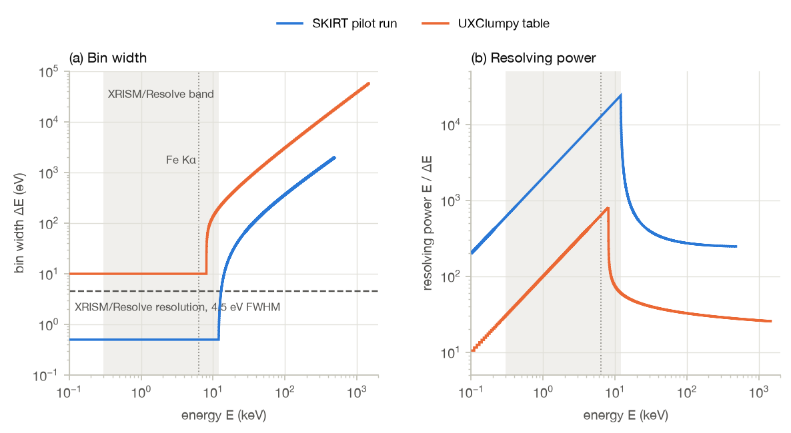
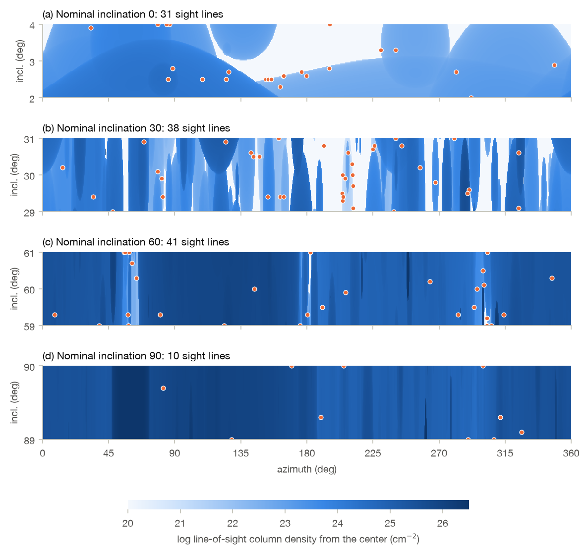

# SKIRT pilot run

## Setup

### Geometry

The pilot run uses the geometry file provided by the author of UXClumpy,
`10000_30_f3_gexp5core.hdf5`, with 10 000 clouds including an inner ring of six clouds (see
Reference model). Using this file avoids recreating the cloud distribution. Its clouds are converted
to a text column file bundle named `clouds` in the HDF5 input file of the pilot run, which is read
by both the `ParticleMedium`, with the `UniformSmoothingKernel`, and the
`ClumpySphericalSpatialGrid`. The bundle lists the center position and radius of each cloud,
scaled to an outer radius Rout of 1 pc, an arbitrary choice because the X-ray
radiative transfer depends only on column densities. Its last column lists the number of hydrogen
atoms in each cloud, nH (4π / 3) r3 with nH = NH /
(2 r) as in XARS, because a `ParticleMedium` imports a number rather than a density. A test run
confirmed that the grid accepts all 10 000 clouds, with a spatial domain extending to 1.1 pc, and
that SKIRT recovers the intended density of every cloud.

The geometry corresponds to `TORsigma` = 42 and `CTKcover` = 0.6 and is not part of the released
table, so that its spectra can be compared with the table spectra only indirectly, for example
through the closest released geometry with the same inner ring, `TORsigma` = 28 and `CTKcover` =
0.6, which serves as reference geometry for the example spectra in the Reference model chapter.

### Source

An isotropic point source at the center emits a cutoff power law with photon index Γ = 1.8 and
cutoff energy `Ecut` = 200 keV, in the range from 0.1 to 500 keV. This is the source spectrum
used for the example output spectra in the Reference model chapter, and it is close to typical
values for nearby AGN. The range is capped at 500 keV, above which the cross sections of the SKIRT
X-ray material mix are zero, whereas the UXClumpy source extends to 1517.5 keV (see Next steps).
For this source spectrum, the photons above 500 keV carry only 0.9% of the energy emitted up to
1517.5 keV.

The source spectrum is provided to SKIRT in the tabulated column format read by `FileSED`, as a
text column file bundle named `source_spectrum` in the HDF5 input file of the pilot run, a
capability introduced in SKIRT 10. The bundle lists the energy in keV and the photon luminosity
per unit energy in 1/s/keV, with an arbitrary normalization, since the luminosity is normalized in
the ski file.

**Resolution of the table.** SKIRT interpolates a tabulated spectrum log-log, which reproduces a
power law exactly. The interpolation error is caused only by the exponential cutoff and amounts to
h2 / 8 · E / `Ecut` for points spaced by h in ln E. Points spaced uniformly in √E
distribute this error evenly over the energy range: 1200 such points keep the maximum relative
error below 10−6 (8.5 × 10−7), whereas logarithmically spaced points would
require about 4800 points. The number of points hardly affects the performance, because SKIRT
samples the wavelength of a photon packet with a single binary search in the cumulative
distribution, so that the cost grows only with the logarithm of the number of points. A test run
with a luminosity probe confirmed that SKIRT reads the bundle and reproduces the cutoff power law
to within 10−6.

### Spectral resolution

The instruments record the spectra on an energy grid with two parts:

- from 0.1 to 12 keV, bins with a constant width of 0.5 eV, which amounts to 23 800 bins;
- from 12 to 500 keV, 2000 bins whose width grows by a constant factor of 1.00416 from one bin to
  the next, starting at 0.5 eV, so that the bin width increases linearly with energy, to 2.0 keV
  for the last bin.

In the second part, the resolving power E / ΔE thus decreases smoothly from 24 000 at 12 keV, the
value for the last 0.5 eV bin, to 2800 at 13 keV, 590 at 20 keV, 320 at 50 keV, 270 at 100 keV,
and 250 at 500 keV. Above 12 keV, the spectra contain no fluorescent lines, and hard X-ray
instruments have a much lower resolution than XRISM/Resolve. The upper limit of 500 keV is that of
the source (see Source). The grid thus has 25 800 bins, compared with 1000 for UXClumpy (see
Spectral resolution in the Reference model chapter), and the 0.5 eV part accounts for 92% of them.
The 0.5 eV bins sample the energy resolution of XRISM/Resolve, 4.5 eV FWHM, with about nine bins
per resolution element.

*Spectral resolution of the instrument wavelength grid of the pilot run, compared with that of the
UXClumpy table spectra: (a) bin width and (b) resolving power as a function of energy. The shaded
band is the XRISM/Resolve band, from 0.3 to 12 keV, and the dotted line marks the Fe Kα line at
6.4 keV.*

A grid that is linear in energy is not linear in wavelength, and the resolving power of the second
part is not constant, so that neither part can be configured with one of the built-in wavelength
grids. Instead, a single `FileBorderWavelengthGrid` lists all 25 801 bin borders in keV. Like the
source spectrum, the borders are provided as a text column file bundle, named `wavelength_grid`,
in the HDF5 input file of the pilot run. A test run with a luminosity probe on this grid confirmed
that SKIRT reads the bundle and constructs the 25 800 bins as intended.

### Sight lines

UXClumpy provides spectra for the 41 `NHLOS` values, from 1020 to 1026
cm−2 in steps of 0.15 dex, and for three inclination bins (see Calculation method in
the Reference model chapter). The pilot run uses instruments at four nominal inclinations: 0°,
30°, 60°, and 90°. For each inclination, there are up to 41 instruments, with azimuths chosen so
that the column density along the line of sight from the central source equals the `NHLOS` grid
values. The azimuths thus differ from one geometry to the next, and grid values that do not occur
near a given inclination are missing. As in UXClumpy, the lowest grid value stands for unobscured
lines of sight. In terms of the UXClumpy inclination bins, the nominal inclinations 0° and 30°
both fall in the face-on bin (0° to 48.2°), 60° in the intermediate bin (48.2° to 70.5°), and 90°
in the edge-on bin (70.5° to 90°).

The column density through a uniform sphere drops continuously to zero at its edge, so that the
column density along a ring of constant inclination is a continuous function of the azimuth, and
every value between its minimum and maximum along the ring is reached exactly. The search thus
needs no tolerance on the column density. It finds all azimuths at which the column density equals
a grid value, on rings within a small range of inclinations around the nominal value, and selects
the direction where the column density changes most slowly with direction, to keep the line of
sight away from cloud edges where possible. The ranges are ±1° around 30° and 60°, 89° to 90°
for 90°, and 2° to 4° for 0°, because a ring at exactly 0° degenerates to a single direction,
which in this geometry passes through a cloud with NH ≈ 1024.2
cm−2. Unobscured lines of sight are placed in the middle of the widest unobscured
stretch of these rings. For the geometry file, this yields 120 instruments:

| Nominal inclination | Instruments | Inclinations | Missing `NHLOS` values (cm−2) |
| --- | --- | --- | --- |
| 0° | 31 | 2° to 4° | 1024.65 to 1026 |
| 30° | 38 | 29° to 31° | 1025.7 to 1026 |
| 60° | 41 | 59° to 61° | none |
| 90° | 10 | 89° to 90° | 1020 to 1024.5 |

Near the poles, the clouds are sparse, so that column densities above 1024.5
cm−2 do not occur, whereas every edge-on line of sight crosses the inner ring, so that
all column densities are higher than that.

*Line-of-sight column density from the center over azimuth and inclination, for the range of
inclinations searched around each nominal inclination, with the selected sight lines (orange
dots). The structures are individual clouds; the white areas are unobscured.*

Most lines of sight cross the interior of a cloud, where log NH changes by at most a
few dex per degree. The lowest column densities, up to between 1020.75 and
1022.1 cm−2 depending on the inclination, are however reached only by
grazing the edge of a thicker cloud, where the column density rises steeply from zero, and the
gradient reaches up to 6 × 104 dex per degree. The inclinations and
azimuths are therefore specified to 8 decimals, which keeps the column densities within
3 × 10−5 dex of the grid values. Such grazing lines of sight are legitimate: the
UXClumpy sky bins for these column densities also cover only a tiny fraction of the sky (see
Example spectra in the Reference model chapter).

A test run with the 120 instruments in a narrow wavelength bin at 30 keV confirmed the directions.
The optical depth, derived from the direct and transparent fluxes recorded by each instrument, is
zero for the unobscured lines of sight, and its ratio to the computed column density is the same
for all other lines of sight to within 1.1 × 10−5.
