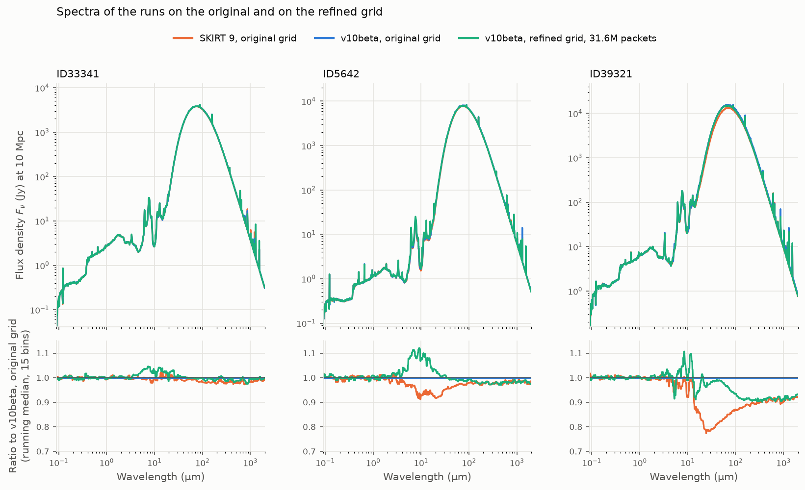

# Results

The proposal was implemented in the SKIRT 10 beta in October 2026. This chapter reports how the
implementation performs for the three COLIBRE galaxies that triggered the proposal: first on the
spatial grid of the SKIRT 9 runs by Andrea Gebek, compared with those runs, and then on a refined
grid that resolves the optical depth of the cells. All v10beta runs used the default convergence
criteria and the rebalance with 10 × 10 bins.

## The COLIBRE galaxies

The three galaxies come from snapshot 56 of the COLIBRE simulations, at redshift 4. They are compact
and dusty: half of their dust mass lies within a few hundred parsec of their center, and the
V-band optical depth along the axes of the domain reaches thousands along at least one axis. Each
galaxy is described by three particle files:

- stellar particles, with their initial mass, metallicity, and age, emitting with the BPASS SED
  family;
- star-forming gas particles, emitting with the Toddlers SED family, normalized to their star
  formation rate over the last 10 Myr;
- dust particles, with the masses of large and small graphite and silicate grains, distributed
  over seven dust medium components (large graphite, large silicate, and small silicate grains, and
  small graphite grains in four parts), with stochastic heating.

| Property | ID33341 | ID5642 | ID39321 |
| --- | ---: | ---: | ---: |
| Stellar particles | 28 525 | 17 852 | 19 243 |
| Star-forming gas particles | 3 225 | 5 897 | 7 213 |
| Dust particles | 15 194 | 21 443 | 22 607 |
| Initial mass of the stellar particles (Msun) | 5.9 × 1010 | 3.6 × 1010 | 3.7 × 1010 |
| Star formation rate (Msun/yr) | 63 | 94 | 280 |
| Dust mass (Msun) | 4.0 × 107 | 6.1 × 107 | 6.9 × 107 |
| Dust half-mass radius (pc) | 528 | 294 | 219 |
| Source luminosity (Lsun) | 9.8 × 1011 | 1.09 × 1012 | 2.83 × 1012 |
| V-band optical depth along the x, y, and z axes | 15, 61, 3101 | 2091, 273, 321 | 1471, 2951, 801 |
| Fraction of the source luminosity absorbed by dust | 84% | 98% | 95% |
| Absorbed secondary / absorbed primary luminosity | 6.1 | 9.4 | 34 |
| Fraction of the dust emission reabsorbed by dust | 86% | 90% | 97% |

The half-mass radius is measured from the dust center of mass, ignoring the smoothing lengths. The
optical depths are those of the particles along the full axes of the domain. The last three rows
come from the converged v10beta runs on the original grid (see below); the self-absorption
depends on the grid and on the number of photon packets, as the refined grid shows.

All runs share the following settings: a cubic domain of 51.4 kpc on a side; a radiation field
wavelength grid with 50 logarithmic bins from 0.09 to 2000 µm; a dust emission wavelength grid with
100 logarithmic bins over the same range and a finer subgrid from 1 to 30 µm; one SED instrument
at a distance of 10 Mpc, viewing along the z axis; and 31.6 million photon packets per emission
segment, unless stated otherwise.

## The original grid

### Setup

The v10beta runs repeat the SKIRT 9 runs of Andrea Gebek with the same input files and the same
spatial grid: a binary tree, subdivided from level 15 up to at most level 36 until each cell holds
less than 10−6 of the dust mass, which gives 402 341, 316 954, and 197 895 cells for
ID33341, ID5642, and ID39321. The runs differ in the following respects:

- The SKIRT 9 runs used the `AllCellsLibrary` and the binned absorption, suffered from the optical
  depth underflow (see the Implementation chapter), and performed 60 plain iterations, because a
  `maxFractionOfPrevious` of 10−5 kept them from stopping earlier.
- The v10beta runs used the `TemperatureWavelengthCellLibrary` with 100 × 50 entries, exact
  absorption, the underflow fix, the rebalance, and the new convergence criteria, with at most 60
  iterations.

### Convergence

The figure shows, for each iteration, the luminosity deficit, the ratio of the absorbed secondary
to the absorbed primary luminosity, and the relative change of the absorbed secondary luminosity
per iteration. For SKIRT 9, these quantities are calculated from the luminosities in the log files,
and the change is relative to the previous iteration, as in its convergence criterion; for v10beta,
they are recorded by the history probe, and the change is the secondary change, averaged over three
iterations.

| Galaxy | Run | Iterations | Deficit, mean of the last three | Absorbed secondary / primary | Absorbed primary luminosity (Lsun) | Spectrum 5–1000 µm, relative to v10beta |
| --- | --- | ---: | ---: | ---: | ---: | ---: |
| ID33341 | SKIRT 9 | 60 | 1.8% | 4.4 | 8.01 × 1011 | 0.989 |
| ID33341 | v10beta | 17 | 0.0% | 6.1 | 8.22 × 1011 | 1 |
| ID5642 | SKIRT 9 | 60 | 3.4% | 6.9 | 1.046 × 1012 | 0.968 |
| ID5642 | v10beta | 21 | 0.1% | 9.4 | 1.071 × 1012 | 1 |
| ID39321 | SKIRT 9 | 60 | 18.4% | 18.0 | 2.52 × 1012 | 0.837 |
| ID39321 | v10beta | 26 | −0.2% | 34.3 | 2.70 × 1012 | 1 |

Plain iteration converges slowly, and its criterion is misleading. With the SKIRT 9 default
`maxFractionOfPrevious` of 3%, the runs would have stopped after 15, 16, and 24 iterations, at a
deficit of 8%, 12%, and 29%, and with an absorbed secondary luminosity of 2.8, 4.2, and 9.8 times
the absorbed primary luminosity, less than half of the converged value. After 60 iterations, the
deficit of ID39321 was still 18%, and its absorbed secondary luminosity was about half of the
converged value and still growing by 1% per iteration.

With the rebalance, the first rebalance multiplies the absorbed secondary luminosity by a factor of
2.4 to 4.3, and the deficit falls below 1% from iteration 8, 8, and 11 (for good from 15). All
rebalances used between 55 and 100 regions, without any fallback to the global factor. As expected,
the secondary change is the last criterion to be met: after the deficit has become small, the
absorbed secondary luminosity still grows by 9 to 21% while the radiation trapped in the core
builds up, and all three runs end when its mean change falls below 0.5% per iteration, while it
still grows by 0.4 to 0.5% per iteration. Whether a stricter `maxSecondaryChange` would change the
observed spectrum noticeably remains to be tested (see Convergence thresholds in the Open questions
chapter).

### Results

The spectrum below 5 µm agrees within 0.2% for all three galaxies, since the transport of the
photon packets did not change. Between 5 and 1000 µm, the v10beta spectrum is 1.1%, 3.3%, and 19.5%
brighter. Several effects contribute, partly in opposite directions:

- **Convergence.** The SKIRT 9 runs had not converged: their escaping dust luminosity fell short of
  the absorbed primary luminosity by the deficit of 1.8%, 3.4%, and 18% at the end of the runs. For
  ID39321, this is the main effect.
- **Optical depth underflow.** The v10beta runs absorb 2.6%, 2.4%, and 6.9% more primary
  luminosity. This is the optical depth underflow, which lost the energy absorbed by segments that
  take the optical depth past 745 (see below), less the small decrease from exact absorption. For
  ID39321, a v10beta run without the underflow fix absorbs 2.51 × 1012 Lsun, 7.0% less
  than with the fix, and the SKIRT 9 run absorbs 0.6% more than that, which is the excess of the
  binned absorption with 50 bins.
- **Binned absorption.** In SKIRT 9, this excess of the absorbed luminosity recurs in every pass and
  is amplified by the self-absorption, which makes the dust emission brighter.
  In the unconverged SKIRT 9 runs, this partly offsets the two effects above.
- **Cell library.** The `TemperatureWavelengthCellLibrary` had no measurable effect for ID39321 in
  other experiments, but it can change the spectrum of less self-absorbing galaxies by a few
  percent. Its effect has not been separated in this comparison.

### The optical depth of the cells

The underflow surfaces because the original grid does not resolve the optical depth: the density
criterion stops subdividing a cell once it holds less than 10−6 of the dust mass,
however opaque the cell is. The table gives the optical depth of the cell diagonals at 0.55 µm, as
reported by the `ConvergenceInfoProbe`, and the fraction of the dust mass in cells with a diagonal
optical depth above a given value:

| Galaxy | Cells | Largest | Average | Mass-weighted average | Dust mass with τ > 10 | τ > 100 | τ > 150 | τ > 500 |
| --- | ---: | ---: | ---: | ---: | ---: | ---: | ---: | ---: |
| ID33341 | 402 341 | 4076 | 6.2 | 231 | 73% | 40% | 31% | 10% |
| ID5642 | 316 954 | 4738 | 13.5 | 210 | 81% | 39% | 30% | 11% |
| ID39321 | 197 895 | 4603 | 23.6 | 486 | 90% | 65% | 57% | 32% |

The plain average is low because most cells lie in the nearly empty outskirts; the average weighted
with the dust mass shows the conditions that the radiation meets. Since the extinction in the far
ultraviolet is up to about five times the extinction at 0.55 µm, segments in cells with a diagonal
optical depth above about 150 can take the optical depth past 745 in the ultraviolet. For all
three galaxies, about a third or more of the dust mass lies in such cells, and the star-forming
regions, which emit most of the ultraviolet, sit in the densest dust. The coarse cells also affect
the optical depth along the axes: for ID39321, the gridded values differ from those of the particles
by +20.7%, +11.1%, and −8.8% along x, y, and z.

## The refined grid

### Setup

The refined grid uses the same binary tree, with the maximum level raised to 60 and a second
subdivision criterion: an `OpticalDepthTreePolicy` subdivides each cell until the optical depth of
its diagonal at 0.55 µm is at most 100 for the dust. This gives 3 463 685, 3 409 889, and 8 612 202
cells, 8.6, 10.8, and 43.5 times more than the original grid:

| Galaxy | Cells | Largest | Average | Mass-weighted average | Dust mass with τ > 10 | Gridding error along x, y, z |
| --- | ---: | ---: | ---: | ---: | ---: | --- |
| ID33341 | 3 463 685 | 100 | 61.6 | 30 | 67% | +30.7%, −6.3%, −1.9% |
| ID5642 | 3 409 889 | 100 | 63.0 | 34 | 75% | +2.1%, −1.5%, +3.5% |
| ID39321 | 8 612 202 | 100 | 80.6 | 54 | 88% | +2.7%, +3.0%, −3.5% |

The gridding error is the relative difference between the gridded optical depth along each axis and
that of the particles; the +30.7% for ID33341 concerns an optical depth of 15. No segment can reach
the underflow threshold on this grid, and the absorbed primary luminosity agrees with that of the
v10beta runs on the original grid within 0.07%, which confirms that the underflow fix recovers the
lost energy on the coarse grid as well.

### Convergence

With 31.6 million photon packets, the runs of ID33341 and ID5642 converged after 19 and 21
iterations, but the run of ID39321 did not converge in 60 iterations: its deficit leveled off at
about 5%. With 8.6 million cells, it has fewer than 4 photon packets per cell and iteration,
against some 9 for the other two galaxies. Further runs of ID39321 with 3.16, 10, and 150 million
photon packets confirm that the number of packets per cell sets the level of this plateau:

With too few packets per cell, the deficit levels off while the secondary change becomes small, and
the absorbed secondary luminosity settles too low: on the refined grid, it is still rising steeply
with the number of packets at 150 million. The plateau is a bias rather than slow convergence:
with 150 million packets, the mean deficit is 1.36%, 1.32%, and 1.30% over iterations 16–30, 31–45,
and 46–60, while the absorbed secondary luminosity changes by less than 0.1% per iteration. Between
the runs, the plateau falls by a factor of 2 to 2.4 for every threefold increase of the number of
packets; extrapolating the last two runs, a plateau below 1% would take some 250 million packets,
about 30 per cell. On the original grid, 16 packets per cell suffice to converge, in 22
iterations; after 30 iterations, the absorbed secondary luminosity is 6% below that of the run
with 160 packets per cell. The refined grid thus needs more packets per cell than the original
grid. The runs of ID33341 and ID5642 on the refined grid converge with some 9 packets per cell,
but their absorbed secondary luminosity is 11% and 25% below that of the original grid; how much of
this difference stems from the resolution and how much from the number of packets has not been
determined.

### Spectra

The spectra below 5 µm agree within 0.3% between all runs. Compared with the v10beta run on the
original grid, the run on the refined grid changes the spectrum between 5 and 1000 µm by less than
1% in total for ID33341 and ID5642, with up to 4% and 10% more emission in the mid-infrared, around
10 µm, presumably from warm dust near the sources that the original grid averages over larger
cells. For ID39321, the run with 31.6 million packets is 3.4% fainter between 5 and 1000 µm, mostly
beyond 100 µm, which reflects its deficit of about 5%. The run with 150 million packets is 1.7%
brighter: 2 to 3% brighter between 20 and 70 µm, and 1 to 4% fainter beyond 100 µm. The emission
beyond 100 µm follows the temperature of the bulk of the dust: the mass-weighted mean of the
indicative dust temperature is 70.9 K and 74.3 K for the runs with 31.6 and 150 million packets,
against 76.2 K on the original grid.

The spectrum of ID39321 does not reveal the deficit of the runs on the refined grid. Over all
directions, the escaping dust luminosity of the run with 150 million packets is 1.8% below that of
the run on the original grid, in line with the difference of their deficits, whereas the flux
between 5 and 1000 µm along the line of sight is 1.7% higher; for the run with 31.6 million
packets, both are lower, by 5.7% and 3.4%. The refined grid apparently sends a larger share of the
dust emission along the z axis, the axis with the lowest optical depth of this galaxy. For ID33341
and ID5642, the two ratios agree within 0.4%. The luminosity deficit, logged and recorded by the
history probe, rather than the spectrum, therefore shows whether a run has converged.

## Performance

### Cost of exact absorption

A timing test compared builds just before and after the implementation using a simulation of the
galaxy ID39321 with seven dust components, stochastic heating, the `TemperatureWavelengthCellLibrary`,
and a single secondary emission iteration. Exact absorption makes the primary emission 22% slower
and a secondary emission iteration 14% slower. The final secondary emission, which stores no
radiation field, is not slower.

### Comparison with SKIRT 9

The three galaxies were run on the original grid with the public SKIRT 9 (commit `4c8330f`) and
with v10beta (commit `12c1f50`), three times each, alternating between the two builds, with 20
threads on a machine with 20 logical cores. To keep the configurations as similar as possible,
both builds used the `TemperatureWavelengthCellLibrary` with 100 × 50 entries and performed
exactly four secondary emission iterations; the v10beta runs included exact absorption and, from
the second iteration on, the rebalance. The table lists the mean run time of the primary emission
and of a secondary emission iteration, averaged over iterations 2 to 4, which v10beta
rebalances. The repetitions agree within a few percent.

| Galaxy | Primary emission, SKIRT 9 | Primary emission, v10beta | Secondary iteration, SKIRT 9 | Secondary iteration, v10beta |
| --- | ---: | ---: | ---: | ---: |
| ID33341 | 220 s | 140 s (−36%) | 120 s | 87 s (−28%) |
| ID5642 | 156 s | 104 s (−33%) | 107 s | 77 s (−28%) |
| ID39321 | 145 s | 94 s (−35%) | 93 s | 65 s (−30%) |

The v10beta runs are about a third faster in both phases, despite the cost of exact absorption.
Most of the gain comes from the restructured tree grids (see the
[Tree-based spatial grids](tree-based-spatial-grids/01-introduction.md) design note), helped by
the known initial cell of a path and link-time optimization: the final secondary emission, which
stores no radiation field and thus measures the cost of the photon paths alone, is 49–54% faster.
Exact absorption takes back part of this gain in the phases that store the radiation field. The
rebalance costs little: forming the regions and solving the system take less than 0.1 s per
iteration, and the tallies along the photon paths add 1–4% to an iteration, judging from the
difference between the first iteration, which is not rebalanced, and the later ones. The peak
memory use is 16–24% lower, which corresponds to about 500 bytes less per node of the tree.
